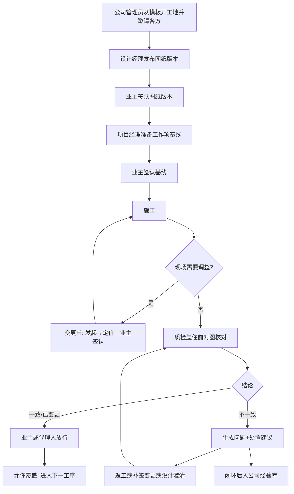
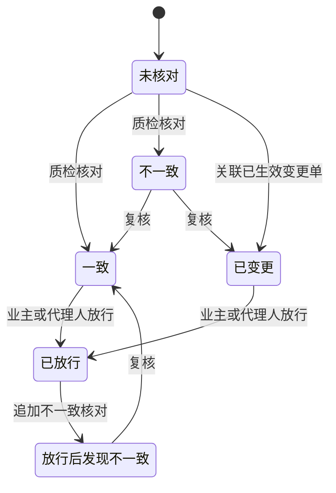
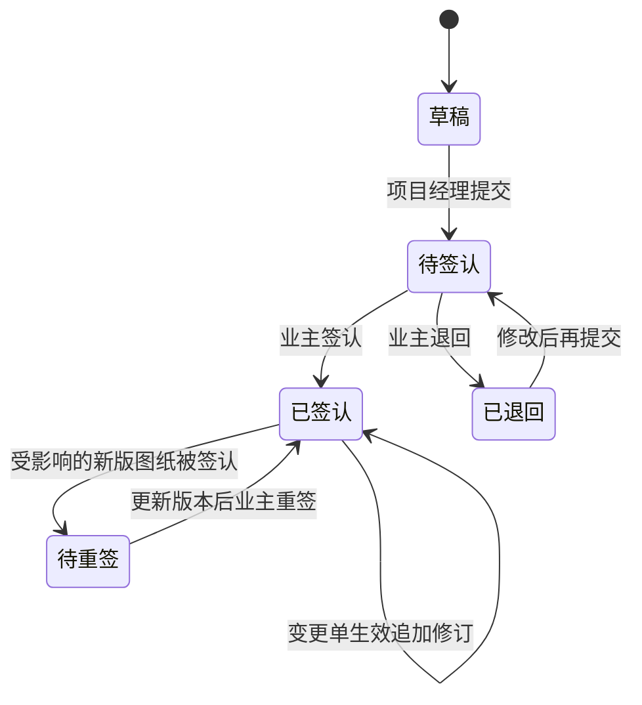

# 君华装修项目管理平台（证据链版）· PRD

**版本**: v2（2026-10-27：需求契约 revision 2，见 requirements-analysis.md RA-016 至 RA-024）
**状态**: 定稿（PRD 核心）
**作者**: PRD 大师协作产出（操作者：刘老师）
**日期**: 2026-10-27
**品类**: B 端 SaaS（单公司部署的多工地协作平台）

> 本文沿用 `requirements.md`（revision 2）的稳定 ID。上游依据为 `output/解题方案书.md`（已确认），以及 `scene-anchor.md`、`proposal-v1.md`、`debate-log.md`。原型 v1.20 只作为前身参考。

---

## 0. 阶段路线图与 MVP 定义

| 阶段 | 已确认目标 | 功能模块 | 交付物（做完用户拿到什么） |
| :--- | :--- | :--- | :--- |
| 全量交付 | 把原型 v1.20 的全部能力迁成装修公司运营的多工地在线协作平台，并加上「签认基线 → 图纸版本与变更单 → 盖住前对图检查 → 业主放行」的不可篡改证据链 | F01–F18 | 公司可以开工地、邀请各方；各方用手机或电脑完成签认、核对、放行、变更；业主能看到进度和四项证据链指标，并随时导出证据包 |

> **本次范围与完成定义**：
> - **范围**：scope = 全量交付，覆盖 F01–F18，不分期，不缩减成 MVP。来源：阶段 1 用户选择「全部保留，再加证据链」，并确认了场景锚点。
> - **端**：只做一套手机和电脑都能用的网页。
> - **接口**：对外只有文件接口，包括 Excel/CSV 计划导入导出、原型 JSON 导入、证据包 ZIP 导出、计划留档 CSV 导出。不对接第三方系统接口。
> - **完成定义**：`requirements.md` 中全部 active 的 REQ/AC 可以在真实工地上按角色操作并被观察到，且总览能直接算出 AC-F10-04 至 AC-F10-07 四项指标。
> - **明确不做**：短信或企业微信推送、微信小程序或原生 App、第三方电子签、资金托管与自动扣款、AI 识图或识别变更、多公司 SaaS 计费、CAD 在线解析。

---

## 1. 项目背景与收益

### 1.1 需求简介（一句话）

装修工地上，图纸和现场「对不上」，往往要到交房后才发现，只能妥协接受。本产品让各方在开工前签认每项工作的基线，在工序被盖住前对图核对并由业主放行，所有记录只能追加、业主可以自主导出，从而把发现时点前移到覆盖之前，有分歧时凭证据定责。

### 1.2 收益预估

#### 用户收益

- **业主**：不一致尽量在被下一道工序盖住前发现。目标是水电阶段至少 90% 的不一致在覆盖前发现。依据：用户确认的成功标准（解题方案书第 6 节）。基线方面，用户陈述历史上「基本交房后才发现」，属于待验证的假设值，由数据小试核实。
- **业主**：有分歧时能拿出签认版图纸、对图照片和变更单。依据：京津冀示范合同的变更签字与隐蔽验收条款（来源：https://scjgj.beijing.gov.cn/bsfw/bmfw/sfwbbm/jjjht/202312/P020231205615140227980.doc ）。
- **项目经理、设计经理、质检、预算专员**：各自的待办集中在平台里，不用再翻微信群找图纸和约定。

#### 业务收益

业务目标如下（本次不设营收类指标；平台由公司自用运营，不对外收费）：

- 隐蔽检查点合规率：装修公司在多个工地按同一套检查点和公司经验库执行，目标为 100%，减少因不一致导致的返工与妥协。用户估算一套房会有几十次不一致（假设值，待验证）。
- 变更先签后做比例：目标为 100%，减少增项纠纷。依据：上海 2019 年家装投诉抽样中，增项占 23.72%（来源：https://www.shzsxh.cn/article/detail?id=313 ）。

#### 不做风险

- 继续出现结构性等不可逆偏差，只能妥协接受（依据：用户原话，解题方案书第 1 节）。
- 发生争议时缺少书面合意证据。法院按书面合意判决（来源：https://www.huichenglawyer.com/pufaku/76249.html ）。

---

## 2. 用户画像

### 2.1 角色与权限矩阵（B 端必须）

| 角色 | 典型职位 | 公司规模 | 行业 | 决策权 | 使用频次 | 关键场景 |
|------|---------|---------|------|--------|---------|---------|
| 公司管理员 | 装修公司运营或行政负责人 | 单家装修公司 | 住宅精装 | 开项目、配成员、重置密码、维护模板；**不能改删任何关键记录** | 每个工地开工前集中使用，之后按需 | 从模板开工地，邀请成员 |
| 业主 | 房主（核心使用者） | — | — | 签认基线、图纸版本、变更单；放行检查点；指定代理人；导出证据包 | 每道工序节点 | 开工前签认，盖住前放行 |
| 业主方成员 | 业主家人或自聘监理 | — | — | 只读本项目；被业主指定为代理人后才有放行权（AC-F01-12） | 按需 | 陪同业主看进度，作为代理人候选 |
| 业主代理人 | 业主家人或自聘监理 | — | — | 只能放行检查点 | 业主不在现场时 | 代为放行 |
| 项目经理 | 施工方项目经理 | 每个工地 1 名 | 住宅精装 | 维护结构与工作项、准备基线、发起变更、登记出勤与问题、推进项目状态 | 每天 | 准备基线，发起变更，处理问题 |
| 设计经理 | 设计单位负责人 | — | 住宅精装 | 发布图纸版本与改动说明、标出受影响工作项 | 改图时 | 发布新版，确认检查点位置 |
| 质检 | 公司质检员 | — | 住宅精装 | 定义检查点、对图核对、给出不一致的原因、审核经验库 | 每道隐蔽工序 | 盖住前拍照对图 |
| 预算专员 | 公司预算员 | — | 住宅精装 | 给变更单定价、维护付款节点 | 有变更时 | 变更定价 |

权限补充：
- 业主对项目结构和工作项只读；业主只能邀请「业主方成员」（AC-F02-09）。
- 公司管理员对各项目的业务数据只读，不能签认、核对、放行或定价（AC-F01-13）。
- 基线费用由项目经理或预算专员在提交前填写，提交后锁定。
- 装修合同专区只对业主、项目经理、预算专员、公司管理员开放。
- 同一人可以在同一项目或不同项目中兼任多个角色（REQ-F01-02）；一个项目可以有多名业主（REQ-F01-06），最多一名业主代理人（AC-F01-08）。

### 2.2 明确不是谁

- ❌ 施工工人：不直接使用平台，通过项目经理和质检间接参与。
- ❌ 多家装修公司共用的 SaaS 平台：本期只做单公司部署（场景锚点默认值，用户已确认）。
- ❌ 第三方资金托管方：付款只做提示，不涉及资金（D-6）。

### 2.3 用户故事

- **US-F01-01**: 作为公司管理员，我希望从公司模板创建项目并邀请成员担任角色，以便每个工地开工前各方职责与权限明确
- **US-F01-02**: 作为业主，我希望指定一位业主方代理人在本人无法及时处理时放行检查点，以便不在现场时放行不卡工期，且仍由业主方把关
- **US-F02-01**: 作为项目经理，我希望用邀请链接把各方拉进项目，以便不依赖外部通道即可开通账号
- **US-F02-02**: 作为业主，我希望用手机号和密码安全登录，以便只有本人能以自己的身份签认和放行
- **US-F03-01**: 作为公司管理员，我希望维护工段、楼层、房间、工作项、工序说明与检查点模板，以便新工地不用从零录入上百项工作
- **US-F03-02**: 作为项目经理，我希望在复制来的结构上增删改楼层、房间、工段和工作项，并整批导入导出，以便项目结构与真实房屋和施工计划一致
- **US-F04-01**: 作为设计经理，我希望上传新版图纸、写明改动并标出受影响工作项，以便现场只按最新签认版施工，改图有据可查
- **US-F04-02**: 作为业主，我希望逐版签认图纸，以便改图不再只签最终版
- **US-F05-01**: 作为项目经理，我希望在开工前把每项工作的图纸版本、做法、费用、顺序、质检人和证据要求写清楚，以便先讲清再干活
- **US-F05-02**: 作为业主，我希望看清每项内容后签认，以便以后有争议都拿签认基线对照
- **US-F06-01**: 作为质检，我希望在隐蔽工序被盖住前对照签认图拍照并给出结论，以便偏差在盖住前被发现
- **US-F06-02**: 作为业主，我希望凭质检证据放行或不放行，以便未经放行不得覆盖
- **US-F06-03**: 作为业主代理人，我希望业主不在时代为放行，以便不卡工期
- **US-F07-01**: 作为项目经理，我希望现场需要调整时先发起变更单，以便变更先签后做
- **US-F07-02**: 作为预算专员，我希望给每张变更单写清费用和工期影响以及谁承担，以便变更费用有据
- **US-F07-03**: 作为业主，我希望看清内容、费用和承担方后签认或驳回，以便不再出现口头约定事后对不上
- **US-F08-01**: 作为质检，我希望判断不一致的原因并得到处置建议，以便按规则定责，不再扯皮
- **US-F08-02**: 作为项目经理，我希望登记、处理并闭环问题，以便问题有始有终
- **US-F09-01**: 作为质检，我希望提交和审核检查经验，以便同样的偏差不在下一个工地或下一道工序重演
- **US-F10-01**: 作为业主，我希望一眼看到进度偏差、问题遗留和四项证据链指标，以便知道工地是否按规矩在走
- **US-F11-01**: 作为项目经理，我希望按工段登记每天的出勤人数，以便人工投入真实可查
- **US-F12-01**: 作为质检，我希望为工作项上传完工照片和验收文件，以便完工资料随工作项可查
- **US-F12-02**: 作为业主，我希望集中查看布局图、效果图和合同，以便资料不再散落在微信群
- **US-F13-01**: 作为项目经理，我希望把口头约定、增项和待办登记成台账，以便约定有据可查
- **US-F13-02**: 作为业主，我希望在公告栏发布留言和回复，以便沟通留痕
- **US-F14-01**: 作为项目经理，我希望调整工段起止日期、班组、权重和施工范围，以便计划变化可追溯
- **US-F15-01**: 作为预算专员，我希望维护合同付款节点，以便付款前看清证据链是否齐全
- **US-F16-01**: 作为业主，我希望登录后立刻看到需要自己处理的事，并能一键催办，以便不再靠翻微信群找事
- **US-F17-01**: 作为业主，我希望确认关键记录不可篡改，并自主导出证据包，以便证据由公司托管也可信
- **US-F18-01**: 作为公司管理员，我希望把原型 v1.20 导出的 JSON 备份导入对应项目，以便砌墙阶段已录的数据不丢

每个 US 都对应 `requirements.md` 中的同名条目，映射关系见 3.1。

---

## 3. 功能需求

### 3.1 功能清单

| ID | 功能 | 所属阶段 | 优先级 | 一句话说明 | 实现 US |
|----|------|---------|--------|----------|---------|
| F01 | 公司、项目与成员角色 | 全量交付 | 必做 | REQ-F01-01, REQ-F01-02, REQ-F01-03, REQ-F01-04, REQ-F01-05, REQ-F01-06, REQ-F01-07 | US-F01-01, US-F01-02 |
| F02 | 账号与登录 | 全量交付 | 必做 | REQ-F02-01, REQ-F02-02, REQ-F02-03, REQ-F02-04 | US-F02-01, US-F02-02 |
| F03 | 项目结构与模板 | 全量交付 | 必做 | REQ-F03-01, REQ-F03-02, REQ-F03-03, REQ-F03-04, REQ-F03-05 | US-F03-01, US-F03-02 |
| F04 | 图纸版本管理 | 全量交付 | 必做 | REQ-F04-01, REQ-F04-02, REQ-F04-03, REQ-F04-04, REQ-F04-05 | US-F04-01, US-F04-02 |
| F05 | 工作项基线签认 | 全量交付 | 必做 | REQ-F05-01, REQ-F05-02, REQ-F05-03, REQ-F05-04, REQ-F05-05 | US-F05-01, US-F05-02 |
| F06 | 检查点、对图核对与业主放行 | 全量交付 | 必做 | REQ-F06-01, REQ-F06-02, REQ-F06-03, REQ-F06-04, REQ-F06-05, REQ-F06-06 | US-F06-01, US-F06-02, US-F06-03 |
| F07 | 变更单 | 全量交付 | 必做 | REQ-F07-01, REQ-F07-02, REQ-F07-03, REQ-F07-04, REQ-F07-05 | US-F07-01, US-F07-02, US-F07-03 |
| F08 | 不一致处置与问题闭环 | 全量交付 | 必做 | REQ-F08-01, REQ-F08-02, REQ-F08-03, REQ-F08-04 | US-F08-01, US-F08-02 |
| F09 | 公司检查经验库 | 全量交付 | 应做 | REQ-F09-01, REQ-F09-02, REQ-F09-03 | US-F09-01 |
| F10 | 总览与指标 | 全量交付 | 必做 | REQ-F10-01, REQ-F10-02, REQ-F10-03, REQ-F10-04 | US-F10-01 |
| F11 | 出勤 | 全量交付 | 必做 | REQ-F11-01, REQ-F11-02 | US-F11-01 |
| F12 | 验收图片、资料库与房屋档案 | 全量交付 | 应做 | REQ-F12-01, REQ-F12-02, REQ-F12-03 | US-F12-01, US-F12-02 |
| F13 | 补充事项与公告栏 | 全量交付 | 应做 | REQ-F13-01, REQ-F13-02 | US-F13-01, US-F13-02 |
| F14 | 计划变更留档 | 全量交付 | 必做 | REQ-F14-01, REQ-F14-02 | US-F14-01 |
| F15 | 付款节点提示 | 全量交付 | 应做 | REQ-F15-01, REQ-F15-02 | US-F15-01 |
| F16 | 待办与提醒 | 全量交付 | 必做 | REQ-F16-01, REQ-F16-02 | US-F16-01 |
| F17 | 审计留痕与证据包 | 全量交付 | 必做 | REQ-F17-01, REQ-F17-02, REQ-F17-03, REQ-F17-04 | US-F17-01 |
| F18 | 原型数据迁移 | 全量交付 | 可做 | REQ-F18-01 | US-F18-01 |

说明：本次范围为全量交付。「必做 / 应做 / 可做」只表示实现先后，**全部都在本次交付内**。「一句话说明」一列列的是该功能对应的需求条目。

### 3.2 详细功能说明（共享层）

#### 3.2.1 通用约定

- **时区与格式**：Asia/Shanghai；日期为 YYYY-MM-DD，时间为 24 小时制。关键记录一律取服务器时间（NFR-008）。
- **国际化**：只支持简体中文。
- **数据权限模型**：按「项目 × 角色」做行级隔离。公司管理员能看到全公司项目的管理信息，其他成员只能看到受邀项目（REQ-F01-03）。经验库是公司级的，内容已脱敏（REQ-F09-01）。
- **关键记录**：以下记录只能追加，任何角色都不能改删，更正只能通过追加新记录完成（REQ-F17-01）：
  - 签认（基线、图纸版本、变更单）
  - 核对与放行
  - 变更单状态
  - 图纸版本
  - 问题状态变化
  - 计划留档
  - 发现时点的修正
- **覆盖时间口径**：取项目经理首次把检查点标记为「已覆盖」，或质检核对时选择「已被覆盖」，两者中较早的时间。从未标记覆盖的检查点，以放行时间计入合规率的分母（RA-006）。
- **交房日期口径**：判断「交房后」时，已登记实际交房日期就用实际日期，否则用计划交房日期（AC-F06-14）。
- **计算口径（沿用原型 v1.20）**：
  - 工段进度 = Σ(工作项权重 × 完成度) ÷ Σ权重；
  - 总体完成度、计划基准按工段权重加权；
  - 工期按自然日含首尾计算（AC-F03-05、AC-F10-01、AC-F10-02）。
- **出勤**：只记录人工登记的数据，不自动生成或推算（AC-F11-03）。原型中用随机数生成的出勤不迁移。
- **退役的原型功能**：「重置演示数据」「固定演示日」「清空公告板块」「本机存储」，由在线存储和从模板建项目取代。

### 3.3 详细功能说明（模块层）

#### 3.3.1 公司、项目与成员角色（F01）

**位置**：项目列表 → 新建项目，以及项目设置 → 成员。
**目标**：每个工地开工前，各方职责与权限都明确。
**业务过程与结果**：
1. 公司管理员选择模板，填写项目名称、地址、计划开工和交房日期，系统创建状态为「筹备」的项目，并复制模板结构。
2. 公司管理员按项目分配角色。业主可以从「业主方成员」等已加入的成员中指定一名业主代理人，代理人只有放行权（AC-F01-12）。
3. 项目经理把项目状态推进到「施工中」「已交房」，推进到「已交房」时必须填写实际交房日期。

**关键边界与失败结果**：
- 访问未受邀项目一律拒绝，不泄露任何数据。
- 成员被移除后立即失去访问权，但历史署名保留。

**规则细则**：REQ-F01-01 至 REQ-F01-07，AC-F01-01 至 AC-F01-11。

#### 3.3.2 账号与登录（F02）

**位置**：邀请链接落地页、登录页、个人设置。
**目标**：不依赖外部通道就能开通账号，只有本人能以自己的身份操作。
**业务过程与结果**：
1. 公司管理员或项目经理生成一条绑定手机号和角色的邀请链接（一次性，7 天有效），一键复制后发到微信。
2. 被邀请人设置密码后加入项目；已有账号的直接关联，不重复建号。
3. 用手机号和密码登录，登录后进入「我的待办」。忘记密码时由管理员重置，临时密码只在重置弹窗中显示一次，首次登录必须改密码（NFR-006）。
4. 被邀请人在邀请页填写自己的姓名，作为签认署名；已有账号的人用原密码加入新项目，不重置密码（AC-F02-02）。

**关键边界与失败结果**：
- 失效的邀请会被拒绝。
- 连续输错 5 次密码锁定 15 分钟。
- 项目经理不能邀请公司管理员。

**规则细则**：REQ-F02-01 至 REQ-F02-04，NFR-006。

#### 3.3.3 项目结构与模板（F03）

**位置**：公司设置 → 模板，以及项目 → 结构 / 计划导入。
**目标**：新工地不用从零录入；结构与真实房屋一致。
**业务过程与结果**：
1. 新项目从模板复制工段、楼层、房间、工作项和工序说明库。君华模板包含 6 个工段、6 层、32 个房间、187 项工作和约 71 条工序规则。
2. 项目经理可以增删改结构，也可以用 Excel 整批导入导出（表结构沿用原型 v1.20）。
3. 工序说明库在名称命中规则时，自动补齐工作说明和验收标准。

**关键边界与失败结果**：
- 已有记录的结构只能停用，不能删除。
- 房间必须属于所选楼层。
- Excel 导入**只新增工作项、更新未签认的工作项**；已签认的逐项提示「需走变更单」。

**规则细则**：REQ-F03-01 至 REQ-F03-05。

#### 3.3.4 图纸版本管理（F04）

**位置**：项目 → 图纸，按分册组织，如「平面布置图」「水电点位图」。
**目标**：现场只按最新签认版施工，改图有据可查（解题动作 ②）。
**业务过程与结果**：
1. 设计经理在分册下上传 PDF 或图片（可另附 CAD），写明「本版改了什么」，并勾选受影响的工作项。新版状态为「待业主签认」。
2. 业主签认后，这一版成为该分册的当前签认版；其中已签认、受影响的工作项基线变为「待重签」。
3. 任意两版可以并排查看。

**关键边界与失败结果**：
- 第 2 版起不写改动说明不能发布。
- 只传 CAD 不能发布。
- 已发布的版本不能删除或替换。

**规则细则**：REQ-F04-01 至 REQ-F04-05。

#### 3.3.5 工作项基线签认（F05）

**位置**：工段页 → 工作项 → 基线；业主待办 → 待签基线。
**目标**：先讲清再干活（解题动作 ①，也是用户原话）。
**业务过程与结果**：
1. 项目经理为工作项准备基线，内容包括：签认版图纸分册与版本、工作说明、验收标准、费用（元）、计划完成日期、质检人，以及至少 1 个检查点。
2. 业主逐项或按工段、楼层批量签认。每项都生成独立的签认记录和内容快照。业主也可以退回并写明理由。
3. 基线在待签认期间锁定，要改须业主先退回（AC-F05-10）；签认后基线锁定，修订只能走变更单或新版图纸重签。
4. 已签认或待重签的工作项可以新增检查点，新检查点直接生效、不改变签认状态，并知会业主；已有检查点不可改删（AC-F06-16）。

**关键边界与失败结果**：
- 字段不齐不能提交。
- 不能引用未签认的图纸版本。
- 待重签期间按原签认版核对，并显著提示。
- 工作项临近施工（计划完成前 7 天）仍未签认的，生成待办。

**规则细则**：REQ-F05-01 至 REQ-F05-05。

#### 3.3.6 检查点、对图核对与业主放行（F06）

**位置**：手机端「检查点」列表 → 检查点详情（图纸钉点 + 核对 + 放行）。
**目标**：偏差在被盖住前发现，未经放行不得覆盖（解题动作 ③）。
**业务过程与结果**：
1. 检查点绑定图纸分册、版本和图上坐标，并标注是否隐蔽。可以引用经验库中的检查要点。
2. 质检在现场拍照（至少 1 张），把照片钉在图纸位置上，给出结论「一致 / 不一致 / 已变更」，并选择当时是否已被覆盖。
3. 结论为「一致」或「已变更」的检查点，由业主或业主代理人放行。
4. 未放行的隐蔽检查点显示红色「不得覆盖」。如果被标记已覆盖，记为「未放行先覆盖」事件。

**关键边界与失败结果**：
- 「已变更」必须关联已生效的变更单。
- 不一致或未核对的检查点不能放行，非业主方也不能放行。
- 重复放行不会生成第二条记录。
- 放行后又发现不一致的，状态改为「放行后发现不一致」。
- 待放行超过时限（默认 24 小时，可设 1–72 小时，由项目经理或公司管理员设置）只升级提醒，**不自动放行**（D-12、AC-F06-17）。

**规则细则**：REQ-F06-01 至 REQ-F06-06，NFR-001。

#### 3.3.7 变更单（F07）

**位置**：项目 → 变更单；补充事项 → 转为变更单；不一致问题 → 补签变更单。
**目标**：变更先签后做，费用和承担方清楚（解题动作 ②）。
**业务过程与结果**：
1. 项目经理发起变更单，填写原因类别、内容、受影响工作项、是否需要新版图纸、现场是否已施工。
2. 预算专员定价：费用增减（元）、工期影响（天）、承担方（业主 / 装修公司 / 设计方）。
3. 业主签认后变更单生效，受影响基线追加修订；业主驳回时必须写理由，项目经理可以修改后重新提交，编号不变（AC-F07-09）。
4. 需要新版图纸的变更单，生效后提醒设计经理出图。

**关键边界与失败结果**：发起时选了「现场已施工」的，记为后补变更，不计入「先签后做」的分子。
**规则细则**：REQ-F07-01 至 REQ-F07-05。

#### 3.3.8 不一致处置与问题闭环（F08）

**位置**：工段页 → 问题卡片；总览 → 问题遗留清单。
**目标**：按规则定责，不再扯皮（解题动作 ④）。
**业务过程与结果**：
1. 核对结论为「不一致」时，系统自动生成问题。
2. 质检选择原因，系统给出对应处置建议：

   | 原因 | 处置建议 |
   |---|---|
   | 设计已改但未签变更单 | 补签变更单（可一键生成草稿） |
   | 施工偏离签认图 | 返工后复核 |
   | 图纸本身未表达清楚 | 设计经理出新版或书面澄清 |

3. 沿用原型的问题登记、等级、超期天数、闭环和重新打开。

**关键边界与失败结果**：
- 由不一致生成的问题，必须复核为「一致」或「已变更」后才能闭环。
- 问题不能删除，只能填理由作废。

**规则细则**：REQ-F08-01 至 REQ-F08-04。

#### 3.3.9 公司检查经验库（F09）

**位置**：公司 → 经验库；新建检查点时的推荐列表。
**目标**：同样的偏差不在下一道工序或下一个工地重演（D-7）。
**业务过程与结果**：
1. 质检把已闭环的不一致问题提交成经验条目，系统自动脱敏。
2. 质检审核后选择状态（未验证经验 / 历史观察 / 已验证），条目对全公司项目可见；每次修改都生成新版本。
3. 新建检查点时，系统按工段推荐经验条目。

**关键边界与失败结果**：经验条目默认不带照片和地址。
**规则细则**：REQ-F09-01 至 REQ-F09-03。

#### 3.3.10 总览与指标（F10）

**位置**：项目总览、楼层 / 房间视图、工段详情页。
**目标**：业主一眼看清进度偏差、问题遗留和证据链是否按规矩在走。
**业务过程与结果**：保留原型 v1.20 的全部总览模块，包括 KPI 卡、甘特图、楼层 × 阶段矩阵、房间短板、房间问题、出勤日历、问题对比、遗留清单、计划变更台账、工段速览卡，以及楼层 / 房间视图和工段详情页。另新增四项证据链指标卡，可按工段筛选并显示目标线：

| 指标 | 目标线 |
|---|---|
| 覆盖前发现比例 | 90% |
| 隐蔽检查点合规率 | 100% |
| 最新签认版使用率 | 100% |
| 变更先签后做比例 | 100% |

**关键边界与失败结果**：分母为 0 时显示「暂无数据」。
**规则细则**：REQ-F10-01 至 REQ-F10-04。

#### 3.3.11 出勤（F11）

**位置**：工段页 → 出勤；总览 → 出勤日历。
**业务过程与结果**：
- 项目经理可以单日登记，也可以批量登记（每天 / 仅工作日 / 仅至今日），人数为 0–40。
- 系统统计累计人工日、日均出勤和峰值。
- 出勤日历按五档着色。

**关键边界与失败结果**：未登记的日期显示「未登记」，不推算人数。
**规则细则**：REQ-F11-01、REQ-F11-02。

#### 3.3.12 验收图片、资料库与房屋档案（F12）

**位置**：工作项「资料」按钮、工段验收图片区、房屋档案五个专区。
**业务过程与结果**：
- 工作项资料可以多文件上传（单个不超过 50MB）。
- 验收图片在「施工中 / 待复验 / 已验收」三种状态间切换。
- 平面布局图、三维效果图、装修合同按分类文件夹管理。默认分类沿用原型：布局图和效果图按楼层分，合同分为主合同、补充协议、报价与变更、付款凭证。

**关键边界与失败结果**：
- 文件删除改为作废并留痕；被关键记录引用的文件不能作废。
- 合同专区设设计经理和质检不可见。

**规则细则**：REQ-F12-01 至 REQ-F12-03。

#### 3.3.13 补充事项与公告栏（F13）

**业务过程与结果**：
- 补充事项台账的字段与状态沿用原型；涉及费用或做法的事项可以一键转为变更单。
- 公告栏按发布者角色自动归入业主、工地经理或设计师板块，留言人取登录账号。

**关键边界与失败结果**：只能删除自己的留言，删除后显示「该留言已删除」。
**规则细则**：REQ-F13-01、REQ-F13-02。

#### 3.3.14 计划变更留档（F14）

**业务过程与结果**：
- 工段计划的起止日期、班组、权重、范围中任一项变化，就追加一条留档，带变更前后值、工期增减天数和原因；字段都没变化时不留档。
- 留档可以导出 CSV。原型的 500 条上限取消。

**规则细则**：REQ-F14-01、REQ-F14-02。

#### 3.3.15 付款节点提示（F15）

**业务过程与结果**：
- 预算专员维护付款节点。
- 节点上显示关联工段中未放行的检查点数和未闭环的不一致数。
- 标记「已付」时如果仍有未放行的检查点，会二次确认，但允许标记（D-6）。

**规则细则**：REQ-F15-01、REQ-F15-02。

#### 3.3.16 待办与提醒（F16）

**业务过程与结果**：
- 登录后首页按角色汇总待办，导航上显示数量，处理完即消失。
- 任意待办都可以「复制微信消息」，消息带直达链接（D-11）。

**规则细则**：REQ-F16-01、REQ-F16-02。

#### 3.3.17 审计留痕与证据包（F17）

**目标**：证据由被监督方托管时依然可信（debate-log #4）。
**业务过程与结果**：
1. 关键记录只能追加，每条都带包含前一条摘要的 SHA-256 串联摘要。
2. 业主或公司管理员可以执行完整性校验。
3. 业主可以按工段、楼层、房间或时间范围导出 ZIP 证据包，内容包括记录清单、照片原件、图纸版本、签认快照和摘要清单。
4. 所有写操作都留操作日志。

**关键边界与失败结果**：只有业主和公司管理员能导出证据包。
**规则细则**：REQ-F17-01 至 REQ-F17-04，NFR-004。

#### 3.3.18 原型数据迁移（F18）

**业务过程与结果**：公司管理员把原型 v1.20 的 JSON 备份导入筹备中的项目。导入的工作事项、问题、出勤、留档、补充事项、留言和验收图片都标注「原型导入」，不生成签认记录；只有元数据的文件标记为「文件缺失」。
**规则细则**：REQ-F18-01。

---

## 4. 流程与状态图表

### 4.1 核心用户旅程（Mermaid）



### 4.2 关键状态机（如有）





变更单：待预算定价 → 待业主签认 → 已生效 / 已驳回。

---

## 5. 边界与异常场景

### 5.1 数据边界

- **空数据**：工段没有工作项时进度为 0%；证据链指标分母为 0 时显示「暂无数据」（AC-F10-08）。
- **超大数据**：单个文件不超过 50MB（AC-F12-02）；单项目的容量见 NFR-009。
- **异常数据**：Excel 逐行校验并给出行号（AC-F03-08）；原型 JSON 格式错误时拒绝导入（AC-F18-03）。

### 5.2 并发与冲突

- **同一检查点重复放行**：只保留第一条放行记录（AC-F06-09）。
- **多名业主**：任一人签认即生效，其他人的待办同步消失（AC-F01-10）。
- **新版图纸与已签基线冲突**：受影响基线进入「待重签」，按原签认版核对并提示（AC-F05-07）。

### 5.3 第三方依赖失败

- **对象存储不可用**：降级为服务器本地磁盘存储，并纳入每日备份（Capability prerequisites）。
- **备案未完成**：先用临时访问地址供项目成员内测。

---

## 6. 成功度量

本次以水电封墙完成为时间窗，统计以下四项证据链指标（定义见 AC-F10-04 至 AC-F10-07，来源：解题方案书第 6 节）：

- 覆盖前发现比例：目标 ≥ 90%
- 隐蔽检查点合规率：目标 100%
- 最新签认版使用率：目标 100%
- 变更先签后做比例：目标 100%

### 6.1 北极星指标

| 指标 / 可观察结果 | 当前基线 | 已确认目标 | 时间窗（如适用） | 来源 |
|------|---------|---------|----------|------|
| 覆盖前发现比例（AC-F10-04） | 用户陈述历史上基本交房后才发现（假设值，待数据小试核实） | 水电阶段 ≥ 90% | 水电封墙完成时 | 解题方案书第 6 节，用户确认 |

### 6.2 关键指标矩阵

| 指标 | 类型 | 基线 | 目标 | 时间窗 | 数据来源 |
|------|------|------|------|--------|---------|
| 隐蔽检查点合规率（AC-F10-05） | 过程 | 未知（此前无记录） | 100% | 水电封墙完成时 | 平台核对与放行记录；来源：解题方案书第 6 节 |
| 最新签认版使用率（AC-F10-06） | 过程 | 未知 | 100% | 水电封墙完成时 | 平台核对记录；来源同上 |
| 变更先签后做比例（AC-F10-07） | 过程 | 未知（此前为口头变更） | 100% | 水电封墙完成时 | 平台变更单；来源同上 |
| 未放行先覆盖事件数（AC-F06-12） | 过程 | 未知 | 0 | 水电封墙完成时 | 平台事件记录；早期信号，来源：事前验尸第 1 条 |

验证方法：水电阶段数据与微信群追溯出的历史基线做前后对比。局限是只有单一工地、没有对照组，只能说明「发现时点前移了」。砌墙阶段（当前）先试运行。

---

## 7. 风险与依赖

### 7.1 技术风险

- **托管方篡改数据库**：影响高。缓解：只追加、摘要串联、完整性校验，业主自主导出并本地保存（REQ-F17-01 至 REQ-F17-03、NFR-004）。
- **手机现场弱网导致照片上传失败**：影响中。缓解：上传失败的照片保留在本机待重传，核对记录在照片全部上传后才提交（设计阶段细化）；性能目标见 NFR-002。

### 7.2 商业风险

- **公司各角色不在系统里操作，检查流于形式**：影响高（A-002）。缓解：配合要求写进补充协议；「不得覆盖」和「未放行先覆盖」事件让缺失可见；砌墙阶段试运行。
- **系统内签认的法律证明力**：影响中（A-003）。缓解：上线前由业主咨询律师；后续可接第三方电子签。

### 7.3 外部依赖

- **公有云服务器、域名、ICP 备案**：由装修公司负责，首次上线部署前完成（D-9）。
- **对象存储**：由装修公司提供凭据，系统级部署配置（D-9）。
- **HTTPS 证书**：使用云厂商提供的免费证书，由装修公司在上线前申请。
- **异地备份位置**：对象存储未到位、文件存在本地磁盘时，公司需提供异地备份位置（NFR-005）。

---

## 8. 验收标准（5 维必须覆盖）

### 8.1 主流程

| 用户场景 | 前置条件 | 操作 | 产品可观察结果 |
|---------|---------|------|----------------|
| 开工地 | 公司管理员已登录 | 从模板新建项目并邀请 5 类成员 | 项目创建成功，结构已复制，成员按角色加入（AC-F01-01、AC-F02-02） |
| 图纸签认 | 设计经理已上传新版 | 业主签认 | 成为当前签认版，受影响基线变为「待重签」（AC-F04-06、AC-F04-07） |
| 基线签认 | 基线字段齐全 | 业主批量签认一个工段 | 每项生成独立签认记录（AC-F05-04） |
| 盖住前核对与放行 | 基线已签认 | 质检拍照钉点给出「一致」，业主放行 | 生成核对与放行记录，「不得覆盖」标记消失（AC-F06-03、AC-F06-06） |
| 变更 | 现场需要调整 | 发起 → 定价 → 签认 | 变更单生效，基线追加修订（AC-F07-04） |
| 看指标 | 有核对数据 | 业主打开总览 | 显示四项证据链指标和目标线（AC-F10-04 至 AC-F10-07） |
| 导出证据 | 有记录 | 业主导出某工段证据包 | 得到含摘要清单的 ZIP（AC-F17-04） |

### 8.2 异常分支

| 场景 | 前置 | 操作 | 期望 |
|------|------|------|------|
| 不一致 | 现场与签认图不符 | 质检核对选「不一致」 | 自动生成问题，按原因给出处置建议，不能放行（AC-F08-01、AC-F08-02、AC-F06-07） |
| 未放行先覆盖 | 隐蔽检查点未放行 | 项目经理标记已覆盖 | 生成事件，业主可见（AC-F06-12） |
| 放行超时 | 待放行超过 24 小时 | 无操作 | 待办标为超时并置顶，不自动放行（AC-F06-13） |
| 导入冲突 | 文件中修改了已签认项 | 导入 | 已签认项不变，结果列出「需走变更单」（AC-F03-09） |

### 8.3 权限与角色

| 场景 | 角色 | 操作 | 期望 |
|------|------|------|------|
| 越权访问 | 未受邀成员 | 访问项目 | 拒绝，不返回数据（AC-F01-05） |
| 改删关键记录 | 公司管理员 | 删除签认记录 | 拒绝（AC-F17-01） |
| 放行 | 项目经理 | 放行检查点 | 拒绝（AC-F06-08） |
| 代理放行 | 业主代理人 | 放行检查点 | 成功并标注代理（AC-F01-07） |
| 合同资料 | 设计经理 | 打开合同专区 | 拒绝（AC-F12-06） |

### 8.4 兼容性

| 平台/浏览器 | 期望 |
|-----------|------|
| iOS Safari 16+、安卓微信内置浏览器 | 核对、放行、签认流程无横向滚动，可以调起相机（NFR-001、NFR-007） |
| Chrome / Edge 最新两个大版本（电脑） | 总览与矩阵完整显示（NFR-001） |

### 8.5 不变行为

| 已有功能 | 本次变更后的预期保持 |
|---------|----------------------|
| 原型的工段进度、总体完成度、工期口径 | 计算公式不变（AC-F03-05、AC-F10-01、AC-F10-02） |
| 原型的总览、楼层 / 房间、工段详情模块 | 全部保留（AC-F10-03、AC-F10-09、AC-F10-10） |
| 原型的工序说明库补齐规则 | 首个命中规则补齐、不覆盖已填内容（AC-F03-10） |
| 原型的 Excel 模板表结构 | 沿用（AC-F03-07），但导入不覆盖已签认项（AC-F03-09） |
| 原型的计划变更留档规则 | 逐字段比对、无变化不留档（AC-F14-01、AC-F14-02） |

---

## 9. 依据清单

### 9.1 用户依据

- 用户在解题阶段的陈述：几十次不一致、结构性错误只能妥协、图纸改过十版只签最终版、变更靠口头。来源：`output/解题方案书.md` 第 1 节、`solution/state.json`。
- 阶段 1 的产品决定 D-1 至 D-12。来源：`state.json.key_decisions_made`、`scene-anchor.md`。
- 原型 v1.20 源码：`input/原型-v1.20.html`。

### 9.2 竞品依据

- 照片钉在图纸位置、图纸版本管理（PlanRadar、Fieldwire、Autodesk Construction Cloud）。来源：`solution/evidence/先例.md`。
- 节点验收加业主确认后放款（贝壳被窝、齐家网）。来源同上。

### 9.3 行业 Benchmark

- 京津冀家装示范合同（2023）中的变更签字与隐蔽验收条款。来源：`solution/evidence/方法.md`。
- 上海家装投诉中增项与质量的占比。来源同上。
- 「与设计不符」没有公开统计占比（证据缺口）。

### 9.4 内部假设

- 见 assumptions.md（A-001 至 A-005）。A-002 在砌墙试运行期间验证，A-003 在上线前咨询律师，都不阻塞本 PRD。

---

## 10. 附录

### 10.1 术语表

| 术语 | 含义 |
|------|------|
| 基线 | 一个工作项开工前经业主签认的内容：图纸版本、做法、验收标准、费用、计划、质检人、检查点 |
| 检查点 | 工作项在签认图纸上的一个钉点位置，需要核对；隐蔽检查点必须在覆盖前核对并放行 |
| 放行 | 业主或业主代理人确认检查点可以被覆盖、进入下一工序 |
| 不得覆盖 | 未放行的隐蔽检查点上显示的红色标记 |
| 未放行先覆盖 | 隐蔽检查点在放行前被标记为已覆盖的事件 |
| 后补变更 | 发起时现场已经按此施工的变更单 |
| 证据包 | 业主导出的 ZIP 文件，包含记录、照片、图纸、签认快照和摘要清单 |
| 摘要串联 | 每条关键记录的摘要都包含上一条的摘要，用来发现事后篡改 |

### 10.2 关联资料

- 设计稿：待 design-master 产出。
- 调研记录：`solution/evidence/先例.md`、`solution/evidence/方法.md`。
- 假设清单：assumptions.md。
- 辩论记录：debate-log.md。
- 业务确认来源：`scene-anchor.md`（阶段 1 确认）、`proposal-v1.md`（D-12）、`solution/state.json`（解题确认）。

### 10.3 关键决策

| 类型 | 决策 | 未选方案 | 为什么 | 主要代价 |
|------|------|---------|--------|---------|
| 产品 | 解法路线：规则 + 证据链，第一版不用 AI | AI 识别变更；独立监理 | 病根是没有签认基线、口头变更、发现晚，规则就能解决 | 需要公司配合，开工前要列检查点 |
| 产品 | 支持多个工地，由装修公司运营（D-1、D-5） | 只服务单个工地；业主运营；第三方 SaaS | 用户决定，并且经验库可以跨工地复用 | 证据由被监督方托管，需要防篡改设计 |
| 产品 | 原型功能全部保留，再加证据链（D-2） | 只保留相关功能；逐项确认 | 原型已迭代到 v1.20 并在使用 | 本次范围最大 |
| 架构 | 手机和电脑都能用的网页（D-3） | 微信小程序；原生 App | 不用上架审核，现场和电脑都能用 | 没有系统推送，需要备案 |
| 产品 | 系统内签认，只追加留痕（D-4） | 第三方电子签 | 不按次收费，书面合意加可追溯一般够用 | 没有 CA 背书（A-003） |
| 产品 | 放行可以委托代理人，超时只提醒（D-12） | 超时自动放行；只能本人放行 | 兼顾工期和把关 | 可能仍会拖工期 |

---

## 11. 一致性自检（自动生成，校验通过才算定稿）

```
Consistency check（check_consistency.py 实际运行，2026-10-27）:
- User Stories → FR mapping: 30/30 PASS（US-F01-01 … US-F18-01 均映射到 F01–F18）
- 角色矩阵 → User Stories: 30/30 PASS（7 个角色均在 §2.1 声明）
- Business Goals → Metrics: 2/2 PASS（隐蔽检查点合规率、变更先签后做比例 → §6）
- 用户收益映射：脚本未单列该章节；用户收益已在 §6 北极星指标（覆盖前发现比例）覆盖
- 结论：全部 PASS
```
