# 君华装修项目管理平台 技术方案

> 生成时间：2026-10-27
> 基于 PRD：PRD详细版.md（v1 定稿）、requirements.md（revision 2，scope = 全量交付）、设计决策蓝图.md（2026-10-27 已确认）、页面清单.md（28 页）
> 技术方案版本：v1.2（v1.1 按 requirements revision 2 增量同步；v1.2 补记开发阶段的实施偏差，见 §9，原文段落未改写）
> 版本核实：本文所有依赖版本均于 **2026-10-27** 从官方发布来源联网查询（npm registry、PyPI JSON API、官方网站下载/版本页），来源 URL 见 §8.1。查不到的明确写「未核实」。

**设计 ID 规则**（沿用 design-master《追溯与增量同步规范》）：接口 `API-Fnn-nn`、数据实体 `DATA-Fnn-nn`、时序 `SEQ-Fnn-nn`、组件 `CMP-Fnn-nn`。`Fnn` 取所属功能模块；跨模块的公共设计挂在最主要的来源模块下。ID 发布后不重编号、不复用。本文共分配 API 32 个、DATA 47 个、SEQ 11 个、CMP 9 个（rev2 新增 DATA-F16-01、SEQ-F06-03），各对象均标注所覆盖的 REQ/AC/NFR。

---

## 1. 产品技术画像

君华装修项目管理平台是装修公司自己运营、单公司部署的多工地协作网页。它把原型 v1.20（单 HTML、浏览器本机存储）的全部能力迁到服务器上，供多人在线使用，再加一条证据链：「签认基线 → 图纸版本与变更单 → 盖住前对图核对 → 业主放行」。技术上最硬的约束有三条：一是被监督方（装修公司）托管数据，业主仍要相信数据没被改过，所以关键记录只能追加，摘要串成链，证据包可以独立核验；二是质检在工地用手机拍照核对，网络弱，浏览器还包括 iOS Safari 16 和安卓微信内置浏览器；三是全部依赖必须在国内可达，只用蓝图已确认的资源（一台国内公有云服务器、域名与 ICP 备案、S3 兼容对象存储）。用户规模小，单项目 20 个并发用户，所以按「单体 + 单库 + 单机容器」做到最简。

### 1.1 产品形态
- 产品类型：Web App（一套响应式网页，B 端数据密集型工作台）。
- 主要入口：浏览器。电脑用 Chrome / Edge；手机用 iOS Safari、安卓微信内置浏览器（成员通过微信转发的链接打开）。
- 端的数量：单端（手机 < 768px、平板 768–1199px、电脑 ≥ 1200px 共用同一套页面，蓝图 §1）。

### 1.2 核心技术约束

| 约束 | 来源（PRD 章节） | 技术含义 |
| :--- | :--- | :--- |
| 关键记录只追加，任何角色（含公司管理员）都不能改删 | PRD §3.2.1、REQ-F17-01、AC-F17-01、NFR-004 | 关键记录表在应用层不暴露 UPDATE/DELETE 路由；运行时数据库账号对这些表只授 INSERT/SELECT；「当前状态」放在可更新的投影表里，事件放在只追加表里 |
| 每条关键记录带 SHA-256(内容 + 前一条摘要) 串联摘要，可整链校验 | REQ-F17-02、AC-F17-02、AC-F17-03 | 需要确定性的规范化序列化、按项目串行化写入链尾（数据库事务级锁），以及可以重算全链的校验任务 |
| 证据包 ZIP：记录清单 xlsx、照片原件、图纸版本、签认快照、摘要清单（含链尾摘要），1000 张照片以内不超过 5 分钟 | AC-F17-04、NFR-002 | 后台任务流式打包（照片不再压缩），产物存入文件存储后供下载；xlsx 写库要支持大表低内存 |
| 按「项目 × 角色」行级隔离，服务端 100% 校验 | REQ-F01-03、AC-F01-05、NFR-003 | 所有工地内接口挂在 `/api/projects/{projectId}/…` 下，统一权限组件按「成员 × 项目 × 角色」判定；查询集强制按项目过滤 |
| 移除成员、撤销代理人「下一次请求起」生效；改密后其他设备下线；7 天无操作登录失效 | AC-F01-06、AC-F01-09、AC-F02-05、AC-F02-08 | 每次请求实时查库判定权限（不把角色写进长期令牌）；用服务端会话，带滑动过期，支持按账号作废 |
| 邀请制 + 手机号密码，不接短信、不接第三方登录 | D-10、REQ-F02-01~04、NFR-006 | 系统自带账号体系：加盐慢哈希（Argon2id）、失败锁定、一次性邀请令牌、管理员重置临时密码并强制改密；临时密码只在重置弹窗一次性显示、不落日志（NFR-006 rev2，§7.2） |
| 一套响应式网页，手机现场优先；支持 iOS Safari 16+、安卓微信内置浏览器 | D-3、NFR-001、NFR-007 | 前端构建目标要覆盖 Safari 16；不能依赖只支持新浏览器的库（见 §7.5.3 PDF 渲染决策） |
| 现场弱网：照片失败可重传，全部上传成功后才能提交；表单自动存本机草稿 | PRD §7.1、蓝图 §5 | 照片逐张独立上传、可重试；核对表单与待传照片存在浏览器 IndexedDB；提交接口只收已上传的文件 ID |
| 图纸为 PDF / JPG / PNG，单个 ≤ 50MB；检查点钉在图纸上，坐标为相对图纸的归一化坐标 | AC-F04-01、AC-F06-01、AC-F06-03 | 钉点存（图纸版本、页码、x∈[0,1]、y∈[0,1]）；图纸统一渲染成位图供所有浏览器查看 |
| Excel/CSV 导入导出（沿用原型 v1.20 的 5 张工作表），原型 JSON 导入 | AC-F03-07~09、REQ-F18-01 | 服务端 xlsx 读写；先校验、后执行的两段式导入；JSON 导入在单个事务内完成，失败不改数据 |
| 文件放 S3 兼容对象存储（deployment-secret），不可用时降级本地磁盘 + 每日备份 | requirements《External capability configuration》《Capability prerequisites》、蓝图 §7–8 | 存储抽象层提供两个驱动（S3 / 本地目录），用部署配置切换；不做配置页 |
| 单实例、容器化、国内公有云；依赖与前端资源自托管或走国内镜像 | 蓝图 §8、铁律 7 | Docker Compose 单机编排；前端静态资源由 Nginx 自托管，不用任何海外 CDN；npm、PyPI、容器镜像走国内镜像源 |
| 时区 Asia/Shanghai，关键记录取服务器时间 | NFR-008 | 数据库时间统一为 timestamptz，业务「今天」按 Asia/Shanghai 计算；关键记录时间由服务端写入，忽略客户端时间 |
| 指标口径固定（加权进度、自然日含首尾、四项证据链指标、分母为 0 显示暂无数据） | PRD §3.2.1、AC-F03-05、AC-F10-01~08 | 计算集中在服务端一个指标模块，用 SQL 聚合；口径集中实现，便于单测 |
| 单项目 1000 工作项、5000 检查点、20000 张照片，20 并发下 P95 ≤ 1 秒 | NFR-002、NFR-009 | 关系库加针对性索引、列表分页、总览只用聚合查询、照片列表只返回缩略图；不需要缓存层 |
| 每日备份数据库并核对文件清单，保留 30 天，RPO ≤ 24 小时，恢复后摘要链「完整」；本地存储模式下每日备份同步到公司提供的异地位置 | NFR-005 rev2、Capability prerequisites「异地备份位置」 | 定时备份容器（pg_dump + 文件清单核对 + 本地模式异地同步），恢复演练脚本最后一步跑完整性校验（§7.6） |
| 正式域名启用 HTTPS，证书用云厂商免费证书 | Capability prerequisites「HTTPS 证书」（rev2） | Nginx 终止 TLS，证书文件由部署脚本放置；到期前提醒续签（§7.1） |
| 多公司 SaaS 已排除，唯一不可逆约束是项目表带公司标识 | 蓝图 §4 | `project.company_id` 非空外键，单公司部署时固定为一个值（§8.3） |

### 1.3 团队与规模画像
- 团队规模假设：1–2 名全栈工程师配合 AI 编码；部署脚本由 AI 负责（D-9）。所以选型优先考虑 AI 生成准确率高、内置能力多、少拼装的框架。
- 技术栈偏好：没有。原型是原生 HTML/JS，没有可复用的工程代码。
- 用户规模预期：早期。单公司、同时在建的工地不多，单项目 20 个并发用户（NFR-002）。
- 上线时间压力：中。全量交付不分期，但可以先在砌墙阶段试运行（PRD §6）。

### 1.4 非功能性需求

| NFR | 技术落点 | 测量点（交 TDD） |
| :--- | :--- | :--- |
| NFR-001 手机现场可用 | 响应式布局（蓝图断点）；核对、放行、基线签认、变更单签认四个流程在手机上单列布局；拍照用 `<input type="file" accept="image/*" capture="environment">`（CMP-F06-01） | Playwright 在 360 / 390 / 430px 视口跑四个流程，断言 `scrollWidth ≤ clientWidth`；1280px 视口截图核对总览与矩阵完整显示；iOS / 安卓微信真机各做一次拍照上传 |
| NFR-002 响应时间 | 页面数据接口只做索引查询和聚合（§5.1.6）；文件经后端流式转发；证据包走后台任务（SEQ-F17-02） | Locust 模拟 20 并发访问页面数据接口，P95 ≤ 1s；10MB 照片限速 10Mbps 上传 ≤ 15s；1000 张照片导出证据包 ≤ 5 分钟 |
| NFR-003 服务端权限校验 | 统一权限组件 CMP-F01-01 + 项目范围查询基类（§4.5） | 接口权限矩阵测试：每个 API × 每个角色 × 非成员，越权请求 100% 返回 403，且响应体不含业务数据 |
| NFR-004 关键记录防篡改 | 只追加表 + 数据库授权（§5.1.3）+ 摘要链 DATA-F17-01 | 用运行时数据库账号直接执行 UPDATE/DELETE 关键表，断言权限错误；路由表里不存在关键资源的 PUT/PATCH/DELETE；校验覆盖 100% 链上记录 |
| NFR-005 备份与恢复（rev2） | 备份容器每日 pg_dump + 文件清单核对，保留 30 天；本地存储模式下当日备份同步到公司提供的异地位置并校验（§7.6） | 恢复演练：在空库恢复最近一次备份，跑完整性校验得到「完整」；核对清单报告缺失文件数为 0；本地存储模式下演练**从异地副本**恢复，并检查每日备份报告中 `offsite_synced=true` 且异地清单 SHA-256 与本地一致 |
| NFR-006 密码安全（rev2） | Django Argon2PasswordHasher（argon2id）；密码规则校验器；日志过滤密码字段；临时密码只在重置接口响应中返回一次、不落日志（§7.2） | 单测密码规则；数据库中只有 `argon2$…` 格式的哈希；端到端重置一次密码后，对应用日志、Nginx 日志、`audit_log` 全文搜索该临时密码，命中 0 次；再次读取成员信息的任何接口都不返回临时密码 |
| NFR-007 浏览器兼容 | 构建目标覆盖 Safari 16；图纸由服务端渲染成位图，不依赖 pdf.js（§7.5.3） | Chrome / Edge 最新两个大版本、iOS Safari 16 真机、安卓微信真机冒烟 |
| NFR-008 时间与格式 | Django `TIME_ZONE=Asia/Shanghai`、`USE_TZ=True`；序列化统一输出 `YYYY-MM-DD` / `HH:mm`；关键记录时间取数据库事务时间 | 单测在 UTC 15:59–16:01 边界上「今天」的判断（对应北京时间 23:59–00:01） |
| NFR-009 容量 | 索引设计与分页（§5.1.6）；压测数据量 1000 工作项 / 5000 检查点 / 20000 照片 | 用造数脚本生成真实中文数据后重跑 NFR-002 压测 |

---

## 2. 技术栈总览（一张图）

```text
┌──────────────────────────────────────────────────────────────────────────────┐
│ 前端层   │ React 19.3 + TypeScript 6.0 + Vite 8.3 + Ant Design 6.6（主题映射 tokens.css）│
│          │ React Router 8.5 · TanStack Query 5（待办 60 秒轮询）· openapi-fetch       │
│          │ idb-keyval（现场草稿与待传照片）· react-zoom-pan-pinch（图纸缩放与钉点）   │
├──────────────────────────────────────────────────────────────────────────────┤
│ 后端层   │ Python 3.13 + Django 5.2 LTS + Django REST framework 3.18 + drf-spectacular │
│          │ Gunicorn（gthread）· 同镜像后台任务进程（数据库任务表，不引入队列）        │
│          │ 文件处理：Pillow（缩略图）· pypdfium2（PDF 图纸渲染）· openpyxl（读 xlsx）  │
│          │           XlsxWriter（写 xlsx）· 标准库 zipfile / csv / hashlib             │
├──────────────────────────────────────────────────────────────────────────────┤
│ 数据层   │ PostgreSQL 18（单实例容器）· 无缓存 · 无独立搜索引擎                       │
│          │ 文件：S3 兼容对象存储（boto3）｜降级：服务器本地持久化目录                  │
├──────────────────────────────────────────────────────────────────────────────┤
│ 基础设施 │ 国内公有云单台服务器 · Docker Engine + Docker Compose · Nginx 1.30（HTTPS、 │
│          │ 静态资源、反向代理）· 备份容器（pg_dump + 文件清单核对，保留 30 天）        │
│          │ 认证：Django 会话 + Argon2id · 可观测：结构化日志 + 健康检查 + 云主机监控   │
└──────────────────────────────────────────────────────────────────────────────┘
```

运行拓扑（单台服务器，Docker Compose 编排 5 个容器）：

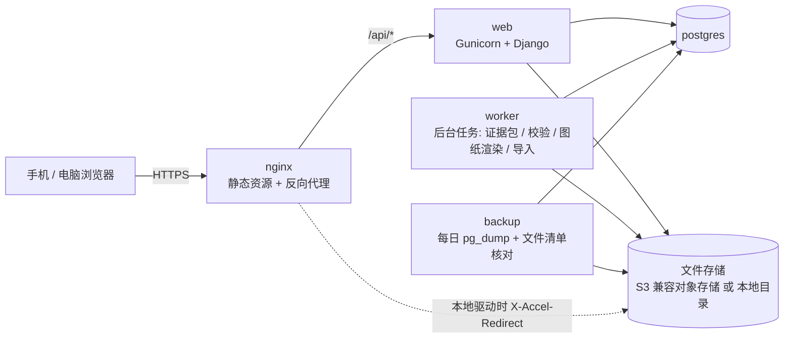

AI 层：不适用（本期没有 AI 能力，PRD §0 明确不做 AI 识图）。

---

## 3. 前端技术选型

### 3.1 候选方案对比

权重：AI 友好度 25%、DX 20%、Eco 20%、Learn 10%、Perf 10%、Scale 5%、TCO 10%。理由：AI 主力编码，页面多（28 页）而且表格和表单密集。

| 候选 | DX | Perf | Eco | AI | Scale | Learn | TCO | 加权总分 |
| :--- | :---: | :---: | :---: | :---: | :---: | :---: | :---: | :---: |
| React 19 + Vite + Ant Design 6 | 4 | 4 | 5 | 5 | 4 | 4 | 5 | **4.55** |
| Vue 3.5 + Vite + Element Plus 2 | 5 | 4 | 4 | 4 | 4 | 5 | 5 | 4.40 |
| Next.js（SSR）+ Ant Design | 3 | 4 | 5 | 4 | 4 | 3 | 4 | 3.90 |

### 3.2 推荐：React 19 + TypeScript + Vite + Ant Design 6

**推荐理由**：
1. 这个产品的电脑端主要是表格、筛选、抽屉、日期选择和多字段表单（项目结构、工作项表、问题台账、操作日志）。Ant Design 6 的 Table、Form、DatePicker、Upload、Drawer 都能直接用，Form 也支持一次列出全部字段错误（蓝图 §5「错误显示在字段旁并列出全部缺失项」）。
2. AI 生成 React + antd 代码的语料最多，样例也最成熟，适合 AI 主力编码（铁律 2）。
3. antd 6 的主题是 Design Token 体系，可以把 `tokens.css` 的颜色、圆角、字号整体映射进去（ConfigProvider theme），保住原型的视觉；印章式状态标签等签名组件用自定义组件实现，不受组件库限制。
4. 纯前端单页应用（SPA）就够了：产品全部在登录后使用，不需要 SEO，也不需要 SSR。SSR 会多一个 Node 运行时容器，与「单体 + 最简」相悖。

**核心配置建议**：
- 路由方案：React Router 8（声明式路由，只用客户端路由，不启用框架模式和服务端渲染）。路由结构对应页面清单：全局页 `/login`、`/invite/:token`、`/me`、`/todos`、`/admin/projects`、`/admin/templates`、`/experience`；工地内页 `/p/:projectId/overview|floors|phases/:phaseId|drawings|drawings/:setId/viewer|baselines|work-items/:id|checkpoints|checkpoints/:id|changes|changes/:id|issues|archive|supplements|notices|payments|members|structure|import|audit`。路由守卫只负责体验（未登录跳登录、强制改密跳个人设置），真正的权限以服务端为准。
- 状态管理：服务端数据一律交给 TanStack Query，不引入 Redux 这类全局状态库。「我的待办」与导航红点设置 `refetchInterval: 60s`，窗口重新获得焦点时也刷新（蓝图 §7）。当前用户、当前工地与角色集合放在一个 React Context 里。
- 接口类型：后端用 drf-spectacular 导出 OpenAPI 3 文档，前端用 openapi-typescript 生成类型，再用 openapi-fetch 调用。前后端字段由同一份契约约束，接口改动会在编译期暴露。
- 样式方案：全局引入 `tokens.css`，antd 主题由 token 映射生成；页面级样式用 CSS Modules，只用 `var(--xxx)`（与 `_外壳约定.md` 一致）。字体用系统中文字体栈，不加载任何网络字体。日期库用 dayjs（antd 6 自带），时区固定为 Asia/Shanghai。
- 构建配置：Vite 8 + @vitejs/plugin-react。`build.target` 显式包含 `safari16`（NFR-007），产物带哈希文件名，由 Nginx 托管并长缓存。不使用任何 CDN 外链；npm 依赖从 `registry.npmmirror.com` 安装。
- 现场能力：核对草稿与待传照片用 idb-keyval 存进 IndexedDB（CMP-F06-01）；离开未保存表单时用路由阻断加 `beforeunload` 拦截。

### 3.3 前端关键组件（CMP）

只列跨页复用、或承载关键业务规则的组件。页面布局和一般表单不单独编号。

| CMP ID | 组件 | 职责与关键行为 | 使用页面 | 覆盖 |
| :--- | :--- | :--- | :--- | :--- |
| CMP-F01-01 | 权限门控 `<Can>` / 无权限页 | 根据 `/api/me` 返回的「项目 × 角色」和权限点隐藏按钮与数据区块（蓝图 §3：隐藏不置灰）；接口返回 403 `PROJECT_FORBIDDEN` 时整页切到 PAGE-F01-03。**只管展示，不是安全边界** | 全站 | AC-F01-05、AC-F12-06、NFR-003 |
| CMP-F04-01 | 图纸查看器 | 显示服务端渲染好的图纸页位图，支持双指缩放和平移（react-zoom-pan-pinch）；钉点图层用归一化坐标 (x,y)∈[0,1] 乘以当前显示尺寸定位，缩放时钉点跟随；新建检查点时点选并回传归一化坐标；顶部显示版本号与「图纸已更新，基线待重签」横幅 | PAGE-F04-02、PAGE-F05-01、PAGE-F06-02 | AC-F04-08、AC-F05-07、AC-F06-01、AC-F06-03 |
| CMP-F04-02 | 双版本对比 | 两个 CMP-F04-01 并排（手机上下排），同步缩放；中间列出两版之间全部版本的改动说明 | PAGE-F04-02 | AC-F04-05 |
| CMP-F06-01 | 现场照片采集与上传队列 | 调起相机或相册；每张照片单独上传（原图，不在前端压缩，保证「照片原件」），失败后留在 IndexedDB 可以重传；显示每张进度；全部成功前「提交」按钮不可用；核对表单字段自动存本机草稿，提交成功后清除 | PAGE-F06-02（也用于验收图片、资料上传） | AC-F06-02、AC-F06-03、AC-F12-01、AC-F12-02、NFR-001、NFR-002 |
| CMP-F06-02 | 印章式状态标签 | 全站统一的状态到印章映射：已签认 / 已放行（绿）、不得覆盖 / 不一致 / 超时（红）、待放行 / 待重签（橙）、代理放行（蓝）。状态值只来自服务端枚举 | 全站列表与详情 | AC-F06-11、AC-F06-13、AC-F01-09 |
| CMP-F06-03 | 不可撤回操作确认摘要 | 签认、放行、驳回、作废、标记已覆盖、标记已付统一走「确认内容摘要」弹窗。摘要由服务端预览接口或当前详情数据生成，确认后提交；提交请求带幂等键（§4.4） | PAGE-F05-02、PAGE-F04-01、PAGE-F06-02、PAGE-F07-02、PAGE-F08-01、PAGE-F15-01 | AC-F05-03、AC-F05-04、AC-F06-09、AC-F15-03 |
| CMP-F10-01 | 指标卡与图表 | 四项证据链指标卡（带目标线，分母为 0 显示「暂无数据」）、甘特图、楼层 × 阶段矩阵、出勤日历（五档着色）。沿用原型的内联 SVG 画法，不引入图表库 | PAGE-F10-01、PAGE-F10-02、PAGE-F10-03 | AC-F10-01~09、AC-F11-04 |
| CMP-F16-01 | 待办列表与「复制微信消息」 | 按类型分组、超时置顶；拼出包含项目名、事项、负责人、截止或超时信息和直达链接的文本（链接域名取部署配置的站点地址），写入剪贴板；剪贴板 API 不可用时退回选中文本框 | PAGE-F16-01 及各详情页 | AC-F16-01~03 |
| CMP-F17-01 | 后台任务进度条 | 用于证据包导出、完整性校验、Excel / JSON 导入：创建任务后轮询任务状态，完成后给出下载或结果 | PAGE-F17-01、PAGE-F03-03 | AC-F17-03、AC-F17-04、AC-F03-08、AC-F18-01 |

**次选**：Vue 3 + Element Plus。团队里已有熟练 Vue 工程师时选它，开发效率相当；本项目由 AI 主力编码，React 生态的样例与组件覆盖面略胜一筹，所以不作首选。

**不推荐**：Next.js / 任何 SSR 框架。所有页面都要登录后才能看，SSR 带不来 SEO 或首屏收益，反而多一个 Node 服务进程、多一层部署与监控。uni-app、Taro 这类跨端框架也不推荐：本期只有一套网页（D-3），引入它们只会增加编译层。

### 3.4 风险与缓解
- 风险 1：antd 6 与 Vite 8 在 iOS Safari 16、安卓微信内置浏览器上的实际兼容性没有官方声明可查（未核实）。→ 缓解：脚手架完成后第一周就在两类真机上冒烟登录、列表、上传三个页面；有问题时只调 `build.target` 与 polyfill，不换框架。
- 风险 2：antd 默认风格与原型风格不一致，返工量大。→ 缓解：第一周先完成 token 映射和 5 个签名组件（印章、指标卡、待办卡、工段色条、确认摘要），再批量做页面。
- 风险 3：IndexedDB 在部分微信内置浏览器或隐私模式下不可用。→ 缓解：草稿功能降级为只在内存中保留，并提示「当前浏览器无法保存草稿」；不影响提交，也不吞掉错误。

---

## 4. 后端技术选型

### 4.1 候选方案对比

权重同 §3，另把 Eco 细化为「本项目的文件处理与认证能力是否现成」。

| 候选 | DX | Perf | Eco | AI | Scale | Learn | TCO | 加权总分 |
| :--- | :---: | :---: | :---: | :---: | :---: | :---: | :---: | :---: |
| Python 3.13 + Django 5.2 LTS + DRF | 5 | 3 | 5 | 5 | 4 | 4 | 5 | **4.65** |
| Python 3.13 + FastAPI + SQLAlchemy 2.1 + Alembic | 4 | 4 | 4 | 5 | 4 | 4 | 5 | 4.35 |
| Node.js 24 + NestJS 12 + Prisma / Drizzle | 4 | 4 | 3 | 5 | 4 | 3 | 4 | 3.95 |
| Java 21 + Spring Boot | 3 | 5 | 5 | 4 | 5 | 2 | 3 | 3.85 |

评分依据（均为 2026-10-27 查证的事实）：
- Django 内置的能力正好覆盖 F02：服务端会话、滑动过期、改密后其他会话自动失效（官方文档 *Session invalidation on password change*）、Argon2 密码哈希器、CSRF 防护、带 `RunSQL` 的迁移（可以把 GRANT / REVOKE 写进迁移）。FastAPI 要自己拼会话、CSRF 和锁定逻辑。
- Node 方案的文件处理生态有硬伤：npm 上 `exceljs` 最新稳定版 4.4.0 发布于 2023-10-19，之后只有预发布版；`xlsx`（SheetJS）npm 版停在 0.18.5（2022-03-24），新版只从海外 CDN 分发，不满足国内可达。ORM 方面，`prisma` 的 npm `latest` 标签当前指向 `8.0.0-rc.27`（预发布版）；`drizzle-orm` 仍是 0.45.x。
- Python 侧：XlsxWriter 3.3.0（2026-10-22）维护活跃；openpyxl 3.1.5（2024-06-28）是读 xlsx 的事实标准；pypdfium2 5.14.0（2026-10-04，BSD-3/Apache-2.0）可以在服务端渲染 PDF，这是 §7.5.3 的关键。
- Spring Boot 性能和扩展性最好，但 20 并发用不上；样板代码多，AI 生成与小团队上手都更慢。

### 4.2 推荐：Python 3.13 + Django 5.2 LTS + Django REST framework 3.18

**推荐理由**：
1. 认证需求（7 天滑动过期、改密踢下线、移除即失效、Argon2）基本是 Django 内置能力，自研代码最少，安全面也最小（REQ-F02-02~04、AC-F02-08、NFR-006）。
2. 只追加 + 数据库授权要求迁移里能写原生 SQL（GRANT / REVOKE），Django 迁移的 `RunSQL` 直接支持，而且迁移与模型在同一处维护（NFR-004）。
3. xlsx 读写、PDF 渲染、ZIP 打包、SHA-256 在 Python 里都有活跃维护或标准库方案，没有国内可达问题（AC-F03-07、AC-F17-04）。
4. 选 5.2 LTS 而不选 6.1：Django 官方支持表显示 5.2 LTS 扩展支持到 2028-04，6.1 到 2027-12；drf-spectacular 0.30.0 的分类器声明支持到 Django 6.0，没有声明 6.1。LTS 生命周期更长，第三方兼容也更稳。升级路径是 2027-04 发布的 6.2 LTS。

**核心配置建议**：
- 工程结构：一个 Django 项目，按领域拆 app：`accounts`（F02）、`projects`（F01）、`structure`（F03）、`drawings`（F04）、`baselines`（F05）、`checkpoints`（F06）、`changes`（F07）、`issues`（F08）、`experience`（F09）、`progress`（F10、F11、F14、F15）、`files`（F12、存储抽象）、`board`（F13）、`todos`（F16）、`ledger`（F17：摘要链、操作日志、证据包、任务）、`migration`（F18）。
- 分层：视图（DRF ViewSet / APIView）只做参数解析与权限声明；业务规则全部放在各 app 的 `services.py`。每个写操作是一个服务函数，内部 `transaction.atomic()` 完成「业务行 + 关键记录入链 + 操作日志」（SEQ-F17-01）。视图层不直接写模型。
- 应用服务器：Gunicorn，`gthread` 工作模式（建议 3 进程 × 8 线程），能并发处理文件流式转发；请求超时 60 秒。
- 后台任务：不引入 Redis 或 Celery。用 `DATA-F17-03 job` 表，加一个同镜像的 `worker` 进程（自定义管理命令），轮询时用 `SELECT … FOR UPDATE SKIP LOCKED` 领取任务。任务类型只有 4 种：证据包导出、完整性校验、图纸渲染、计划与 JSON 导入执行。规模远低于需要消息队列的门槛。
- 定时类需求（放行超时、计划完成前 7 天未签认）全部在读取时按当前时间计算，**不需要定时调度**；唯一的定时任务是备份（§7.6）。
- 依赖安装：`pip` 指向国内镜像（如 `mirrors.aliyun.com/pypi/simple`）；用锁文件固定版本（如 `uv` 或 `pip-tools` 生成的 requirements.lock）。

### 4.3 API 分组

约定：全部接口以 `/api` 开头；工地内接口统一以 `/api/projects/{projectId}` 开头。下表的「主要端点」是分组骨架，具体字段由 OpenAPI 文档生成。

| API ID | 分组 | 主要端点（方法 路径） | 主要角色 | 页面 | 覆盖 |
| :--- | :--- | :--- | :--- | :--- | :--- |
| API-F02-01 | 会话与本人 | `POST /api/auth/login`、`POST /api/auth/logout`、`GET /api/me`（本人、公司管理员标记、各项目角色与权限点、是否必须改密）、`POST /api/me/password` | 全部 | PAGE-F02-01、PAGE-F02-03 | REQ-F02-02、REQ-F02-04、AC-F02-05、AC-F02-06、AC-F02-08、NFR-006 |
| API-F02-02 | 邀请 | `GET/POST /api/projects/{pid}/invitations`、`POST …/invitations/{id}/revoke`、`GET /api/invitations/{token}`（公开，只返回邀请人、项目名和角色）、`POST /api/invitations/{token}/accept`（新账号带姓名与密码；已有账号带原密码，AC-F02-02 rev2） | 公司管理员、项目经理；业主（只能邀请业主方成员，AC-F02-09） | PAGE-F01-02、PAGE-F02-02 | REQ-F02-01、AC-F02-01~04、AC-F02-09 |
| API-F02-03 | 重置密码 | `POST /api/admin/users/{uid}/reset-password`（返回一次性临时密码，只显示这一次；响应带 `Cache-Control: no-store`，响应体不进日志，NFR-006 rev2） | 公司管理员 | PAGE-F01-02 | REQ-F02-03、AC-F02-07、NFR-006 |
| API-F01-01 | 项目 | `GET /api/projects`（按身份过滤）、`POST /api/projects`（从模板创建）、`GET /api/projects/{pid}`、`POST …/status`（状态流转与实际交房日期）、`PATCH …/settings`（放行时限 1–72 小时，仅项目经理、公司管理员，AC-F06-17） | 公司管理员、项目经理 | PAGE-F01-01、PAGE-F01-02、PAGE-F16-01 | REQ-F01-01、REQ-F01-07、AC-F01-01、AC-F01-02、AC-F01-04、AC-F01-11、AC-F06-13、AC-F06-17 |
| API-F01-02 | 成员与角色 | `GET …/members`、`PUT …/members/{uid}/roles`（角色含业主方成员，AC-F01-03 rev2）、`DELETE …/members/{uid}`（移除成员，只删成员关系，不碰历史记录）、`PUT …/owner-agent`、`DELETE …/owner-agent` | 公司管理员、业主 | PAGE-F01-02 | REQ-F01-02、REQ-F01-04~06、AC-F01-03、AC-F01-06~10、AC-F01-12、AC-F01-13 |
| API-F03-01 | 公司模板与工序说明库 | `GET/POST/PATCH /api/admin/templates…`（工段、楼层、房间、工作项、检查点模板）、`GET/POST/PATCH /api/admin/process-rules`（带顺序） | 公司管理员 | PAGE-F03-01 | REQ-F03-01、REQ-F03-05、AC-F03-01、AC-F03-10 |
| API-F03-02 | 项目结构 | `…/floors`、`…/rooms`、`…/phases`、`…/work-items` 的增删改；`POST …/{kind}/{id}/disable`；删除时有关联记录返回 409 `HAS_RECORDS_DISABLE_ONLY`；`PATCH …/phases/{id}/plan`（触发计划留档） | 项目经理 | PAGE-F03-02、PAGE-F10-03 | REQ-F03-02、REQ-F03-03、AC-F03-02~06、AC-F14-01~03 |
| API-F03-03 | 计划 Excel/CSV 导入导出 | `GET …/plan/template.xlsx`、`GET …/plan/export.xlsx`、`POST …/plan/imports`（上传并逐行校验，返回错误清单）、`POST …/plan/imports/{id}/execute`（只有零错误才允许执行） | 项目经理 | PAGE-F03-03 | REQ-F03-04、AC-F03-07~10 |
| API-F04-01 | 图纸分册与版本 | `GET/POST …/drawing-sets`、`GET …/drawing-sets/{id}/versions`、`POST …/drawing-sets/{id}/versions`（multipart：图纸文件、可选 CAD、改动说明、受影响工作项、关联变更单）、`GET …/drawing-versions/{id}/pages`（渲染状态与各页位图地址）、`GET …/drawing-sets/{id}/compare?from=&to=`。**没有** PUT/PATCH/DELETE | 设计经理（写）、成员（读） | PAGE-F04-01、PAGE-F04-02 | REQ-F04-01、REQ-F04-02、REQ-F04-05、AC-F04-01~05、AC-F04-08 |
| API-F04-02 | 图纸签认 | `POST …/drawing-versions/{id}/sign` | 业主 | PAGE-F04-01 | REQ-F04-03、REQ-F04-04、AC-F04-06、AC-F04-07、AC-F01-10 |
| API-F05-01 | 基线 | `GET …/work-items/{id}/baseline`（当前状态、当前修订、修订与签认历史）、`PATCH …/work-items/{id}`（锁定字段在已签认 / 待重签后拒绝；待签认期间整条基线拒绝修改，AC-F05-10）、`POST …/work-items/{id}/baseline/submit` | 项目经理、预算专员（费用） | PAGE-F05-01 | REQ-F05-01、REQ-F05-03、REQ-F05-04、AC-F05-01、AC-F05-02、AC-F05-06、AC-F05-08、AC-F05-10 |
| API-F05-02 | 基线签认与退回 | `GET …/baselines/pending?group=phase|floor`、`POST …/baselines/sign`（批量，传 `revisionIds[]`）、`POST …/baselines/{id}/return`（必填理由） | 业主 | PAGE-F05-02 | REQ-F05-02、AC-F05-03~05、AC-F01-10 |
| API-F06-01 | 检查点 | `GET …/checkpoints?status=&phase=&floor=`、`POST …/work-items/{id}/checkpoints`（含钉点；基线已签认 / 待重签时直接生效并知会业主，待签认时拒绝，SEQ-F06-03）、`GET …/checkpoints/{id}`、`POST …/checkpoints/{id}/cover`（标记已覆盖）、`GET …/checkpoints/suggestions?phaseId=`（经验推荐） | 项目经理、质检（写）、成员（读） | PAGE-F06-01、PAGE-F05-01、PAGE-F06-02 | REQ-F06-01、REQ-F06-04、REQ-F09-03、AC-F06-01、AC-F06-11、AC-F06-12、AC-F09-04、AC-F06-16、AC-F05-10 |
| API-F06-02 | 核对记录 | `POST …/checkpoints/{id}/checks`（照片文件 ID 列表、结论、覆盖状态、关联变更单）、`GET …/checkpoints/{id}/checks`、`POST …/checks/{id}/discovery-corrections`（必填理由）。**没有**修改接口 | 质检（核对）、质检与项目经理（修正发现时点） | PAGE-F06-02 | REQ-F06-02、REQ-F06-06、REQ-F05-04、AC-F06-02~05、AC-F06-10、AC-F06-14、AC-F06-15、AC-F05-07、AC-F08-01 |
| API-F06-03 | 放行 | `POST …/checkpoints/{id}/release`（带幂等键） | 业主、业主代理人 | PAGE-F06-02 | REQ-F06-03、AC-F06-06~09、AC-F01-07、AC-F01-09、AC-F01-10 |
| API-F07-01 | 变更单 | `GET/POST …/change-orders`、`GET …/change-orders/{id}`、`POST …/{id}/price`、`POST …/{id}/sign`、`POST …/{id}/reject`、`POST …/{id}/resubmit`（已驳回单修改后重新提交，编号不变，AC-F07-09）；`POST …/issues/{id}/change-order-draft`、`POST …/supplements/{id}/change-order-draft`（生成预填草稿） | 项目经理、预算专员、业主 | PAGE-F07-01、PAGE-F07-02 | REQ-F07-01~05、REQ-F13-01、AC-F07-01~09、AC-F08-02、AC-F13-02 |
| API-F08-01 | 问题 | `GET/POST …/issues`（筛选、超期排序）、`POST …/issues/{id}/cause`、`…/close`、`…/reopen`、`…/void`（必填理由）、`POST …/issues/{id}/experience` | 成员；闭环与重开限项目经理、质检 | PAGE-F08-01、PAGE-F10-02 | REQ-F08-01~04、REQ-F09-01、AC-F08-01~07、AC-F09-01 |
| API-F09-01 | 公司经验库 | `GET /api/experience?phase=&status=`、`POST /api/experience/{id}/review`、`POST /api/experience/{id}/versions`、`GET /api/experience/{id}/versions` | 公司内成员（读）、质检（审核与修改） | PAGE-F09-01 | REQ-F09-02、AC-F09-02、AC-F09-03 |
| API-F10-01 | 总览与指标 | `GET …/overview`（KPI、计划基准、工期、四项指标，可传 `phaseId`）、`GET …/overview/gantt`、`GET …/matrix?by=floor|room`、`GET …/phases/{id}/detail`、`GET …/floors/{id}`、`GET …/rooms/{id}` | 成员 | PAGE-F10-01、PAGE-F10-02、PAGE-F10-03 | REQ-F10-01~04、AC-F10-01~10、AC-F03-05、AC-F03-06、AC-F08-04 |
| API-F11-01 | 出勤 | `PUT …/phases/{id}/attendance/{date}`、`POST …/phases/{id}/attendance/batch`、`GET …/attendance?month=` | 项目经理（写）、成员（读） | PAGE-F10-03、PAGE-F10-01 | REQ-F11-01、REQ-F11-02、AC-F11-01~04 |
| API-F12-01 | 文件上传与读取 | `POST …/files`（单文件 multipart，返回文件 ID 与 SHA-256；校验大小和格式）、`GET …/files/{id}/content`、`GET …/files/{id}/thumb` | 成员（按引用对象再校验） | 全站 | REQ-F12-01、AC-F12-01、AC-F12-02、AC-F06-02、NFR-002 |
| API-F12-02 | 工作项资料与验收图片 | `GET/POST …/work-items/{id}/attachments`、`POST …/attachments/{id}/void`、`GET/POST …/phases/{id}/acceptance-photos`、`POST …/acceptance-photos/{id}/status` | 成员；作废限上传者 | PAGE-F05-01、PAGE-F10-03 | REQ-F12-01、REQ-F12-02、AC-F12-03、AC-F12-04 |
| API-F12-03 | 房屋档案 | `GET/POST/PATCH/DELETE …/archive/{zone}/folders`（只能删空分类）、`GET/POST …/archive/{zone}/folders/{id}/files`；`zone=contract` 时额外校验合同可见角色 | 公司管理员、项目经理（分类）；成员（上传与查看） | PAGE-F12-01 | REQ-F12-03、AC-F12-05、AC-F12-06 |
| API-F13-01 | 补充事项 | `GET/POST/PATCH …/supplements`、`POST …/supplements/{id}/status` | 成员；转变更单限项目经理 | PAGE-F13-01 | REQ-F13-01、AC-F13-01、AC-F13-02 |
| API-F13-02 | 公告栏 | `GET/POST …/notices`、`POST …/notices/{id}/replies`、`DELETE …/notices/{id}`（只能删自己的，软删除并留占位） | 成员 | PAGE-F13-02 | REQ-F13-02、AC-F13-03、AC-F13-04 |
| API-F14-01 | 计划留档 | `GET …/plan-logs`、`GET …/plan-logs/export.csv` | 成员 | PAGE-F10-03、PAGE-F17-01 | REQ-F14-02、AC-F14-04 |
| API-F15-01 | 付款节点 | `GET/POST/PATCH …/payments`（列表带未放行检查点数和未闭环不一致数）、`POST …/payments/{id}/mark-paid`（服务端返回 N，前端二次确认后带 `confirmUnreleased=N` 再提交） | 预算专员（写）、成员（读） | PAGE-F15-01 | REQ-F15-01、REQ-F15-02、AC-F15-01~03 |
| API-F16-01 | 我的待办 | `GET /api/todos`（跨项目，按类型分组，含超时标记与总数）、`GET /api/todos/count`、`POST /api/todos/ack`（知会类「知道了」，写 DATA-F16-01） | 全部 | PAGE-F16-01、导航红点 | REQ-F16-01、REQ-F16-02、REQ-F05-05、REQ-F06-05、AC-F16-01~03、AC-F05-09、AC-F06-12、AC-F06-13、AC-F04-07、AC-F05-05、AC-F07-02、AC-F07-03、AC-F07-06、AC-F07-07、AC-F07-09、AC-F06-16、AC-F02-05 |
| API-F17-01 | 完整性校验 | `POST …/integrity-checks`（创建任务）、`GET …/integrity-checks/{id}` | 业主、公司管理员 | PAGE-F17-01 | REQ-F17-02、AC-F17-02、AC-F17-03、NFR-004 |
| API-F17-02 | 证据包导出 | `POST …/evidence-exports`（范围：工段 / 楼层 / 房间 / 时间）、`GET …/evidence-exports/{id}`、`GET …/evidence-exports/{id}/download` | 业主、公司管理员 | PAGE-F17-01 | REQ-F17-03、AC-F17-04、AC-F17-05、NFR-002 |
| API-F17-03 | 操作日志 | `GET …/audit-logs?from=&to=&objectType=&objectId=` | 业主、公司管理员 | PAGE-F17-01 | REQ-F17-04、AC-F17-06 |
| API-F18-01 | 原型 JSON 导入 | `POST …/prototype-imports`（只限筹备中的项目；解析失败返回 422 `INVALID_PROTOTYPE_BACKUP`）、`GET …/prototype-imports/{id}` | 公司管理员 | PAGE-F03-03 | REQ-F18-01、AC-F18-01~03 |

### 4.4 通用接口约定
- **错误体统一**：`{ "code": "…", "message": "面向用户的中文提示", "fields": [{ "field": "…", "message": "…" }], "details": {…} }`。表单校验一次返回**全部**错误字段（AC-F01-02、AC-F05-01、AC-F07-01）。`message` 原样使用 AC 规定的文案。
- **分页**：`?page=&pageSize=20|50`（蓝图 §5），响应带 `total`。
- **幂等与重复提交**：签认、放行、驳回、标记已付等不可撤回操作，客户端带 `Idempotency-Key` 请求头；服务端同时用行锁和唯一约束兜底（§5.1.4）。重复请求返回 409，并带原记录的「谁、何时」（AC-F06-09）。
- **关键资源无改删路由**：关键记录资源只注册 GET / POST。对它们发 PUT / PATCH / DELETE 时，由统一兜底路由返回 405 `KEY_RECORD_IMMUTABLE`，提示「关键记录不可修改，更正请追加新记录」（AC-F17-01）。
- **时间**：响应里时间统一为带 `+08:00` 的 ISO 8601，日期为 `YYYY-MM-DD`。请求里的业务日期按 Asia/Shanghai 解析；关键记录时间字段不接受客户端传值（NFR-008）。
- **CSRF**：会话 Cookie 设为 `HttpOnly; Secure; SameSite=Lax`，写请求要校验 CSRF 令牌（Django 内置）。前端与 API 同域，不需要 CORS。

### 4.5 权限校验落点（NFR-003）

1. **认证层**（Django 会话中间件 + 自定义中间件）：未登录返回 401；`must_change_password=true` 时，除 `GET /api/me`、`POST /api/me/password`、`POST /api/auth/logout` 外一律返回 403 `PASSWORD_CHANGE_REQUIRED`（AC-F02-07）。
2. **项目层**（CMP-F01-01 后端部分：DRF 权限类 `ProjectAccess`）：从 URL 取 `projectId`，**每次请求实时查** `project_member_role`（DATA-F01-03）得到当前用户在该项目的角色集合。非成员且非公司管理员时返回 403 `PROJECT_FORBIDDEN`，响应体只有错误码和文案（AC-F01-05）。因为每次都实时查库，移除成员或撤销代理人从下一次请求起生效（AC-F01-06、AC-F01-09）。
3. **动作层**：每个视图动作声明一个权限点（如 `checkpoint.release`、`baseline.sign`），在一张集中的「权限点 → 角色集合」表里判定，矩阵与 PRD §2.1 一一对应。要点：放行 = {业主, 业主代理人}；签认基线、图纸、变更单 = {业主}，代理人不在其中（AC-F01-07、AC-F06-08）；证据包、完整性校验、操作日志 = {业主, 公司管理员}（AC-F17-05）；合同专区 = {业主, 项目经理, 预算专员, 公司管理员}（AC-F12-06）；邀请公司管理员角色仅限公司管理员（AC-F02-04）；放行时限修改 = {项目经理, 公司管理员}（AC-F06-17）。
   - **业主方成员 `owner_member`（rev2，AC-F01-03、AC-F01-12）**：只拥有项目内各读权限点，不在任何写权限点的角色集合里（签认、核对、定价、编辑、上传、标记覆盖等）。被业主指定为代理人后，同一用户再多一行 `owner_agent` 角色，因而获得且只获得 `checkpoint.release`；撤销代理即删除该行。
   - **业主邀请（rev2，AC-F02-09）**：`invitation.create` 授予 {公司管理员, 项目经理, 业主}，但对业主追加参数校验：`roles` 只能等于 `[owner_member]`，否则 403「业主只能邀请业主方成员」。
   - **公司管理员只读（rev2，AC-F01-13）**：公司管理员身份来自 `user.is_company_admin`，不在 `project_member_role` 中。权限判定时，公司管理员对任意项目获得全部读权限点和管理权限点（成员、角色、邀请、重置密码、项目状态、放行时限、证据包与完整性校验），**不**获得签认、核对、放行、定价等业务写权限点，服务端拒绝（403）。若公司管理员本人在某项目另被分配了项目角色，则在该项目再叠加该角色的权限（AC-F01-13 限定「自己没有被分配项目角色的项目」）。
4. **数据层**：项目内视图统一继承 `ProjectScopedViewSet`，查询集固定加 `project_id = 当前项目`，按 ID 取对象也带项目条件，防止拿别的项目的 ID 越权读取（IDOR）。文件读取（API-F12-01）要再校验「文件被哪个对象引用、该对象所在区域对当前角色是否可见」，例如合同文件。
5. **前端**只做隐藏（蓝图 §3），不作为安全依据。

### 4.6 异常处理落点

| 异常 | 检测位置 | 响应（HTTP / code / 文案） | 数据结果 | 覆盖 |
| :--- | :--- | :--- | :--- | :--- |
| 必填缺失、日期颠倒 | 序列化器 + 服务层校验 | 400 `VALIDATION_FAILED`，`fields` 列出全部 | 不写任何行 | AC-F01-02、AC-F05-01、AC-F07-01、AC-F14-03 |
| 房间不属于楼层 | 服务层 | 400，「房间与楼层不匹配」 | 不保存 | AC-F03-04 |
| 删除有记录的结构 | 服务层查引用 | 409 `HAS_RECORDS_DISABLE_ONLY`，「已有记录，只能停用」 | 不删除 | AC-F03-03 |
| 改已签认基线的锁定字段 | 服务层比对锁定字段 | 409 `BASELINE_LOCKED`，「已签认，请发起变更单或等待新版图纸重签」 | 进度字段照常保存 | AC-F05-06 |
| 改待签认基线（含为其新增检查点） | 服务层锁 baseline 行后判断 status=待签认 | 409 `BASELINE_PENDING_SIGN`，「基线待业主签认，需业主退回后才能修改」 | 不保存；进度字段照常保存 | AC-F05-10（rev2） |
| 引用未签认图纸版本 | 服务层 | 422 `DRAWING_NOT_SIGNED`，「该版本尚未签认」 | 不保存 | AC-F05-02 |
| 图纸缺改动说明 / 只有 CAD | 服务层 | 400，「请说明本版改了什么」/「请同时上传 PDF 或图片版，CAD 仅作为附件」 | 不建版本 | AC-F04-02、AC-F04-03 |
| 核对无照片、照片未上传完 | 服务层（文件 ID 必须存在、属于本项目、状态为已上传） | 400，「至少上传 1 张现场照片」 | 不建核对记录 | AC-F06-02 |
| 「已变更」没有关联已生效变更单 | 服务层 | 422，「请关联已生效的变更单」 | 不建记录 | AC-F06-04 |
| 放行未核对 / 不一致 | 服务层（锁住检查点行后判断） | 422 `CANNOT_RELEASE`，说明原因 | 不建放行记录 | AC-F06-07 |
| 非业主方放行 | 权限层 | 403，「只有业主或业主代理人可以放行」 | — | AC-F06-08 |
| 重复放行、重复签认 | 行锁 + 唯一约束 | 409 `ALREADY_RELEASED` / `ALREADY_SIGNED`，「已由某人于某时放行」 | 不建第二条记录 | AC-F06-09、AC-F01-10 |
| 驳回无理由 | 序列化器 | 400，「请填写驳回理由」 | 状态不变 | AC-F07-05 |
| 重新提交非「已驳回」的变更单 | 服务层锁行后判断 | 409 `CHANGE_ORDER_STATE`，「变更单状态已变化，请刷新」 | 不追加事件 | AC-F07-09（rev2） |
| 不一致问题未复核就闭环 | 服务层查检查点最新结论 | 422，「请先由质检复核为一致或已变更」 | 不闭环 | AC-F08-06 |
| 改删关键记录 | 路由兜底 + 数据库授权 | 405 `KEY_RECORD_IMMUTABLE`；绕过应用直接改库时，数据库报权限错误 | 原记录不变 | AC-F17-01、AC-F04-04、NFR-004 |
| 越权访问项目 | 权限层 | 403 `PROJECT_FORBIDDEN`，「无权访问该项目」 | 响应不含业务数据 | AC-F01-05 |
| 合同专区越权 | 权限层 | 403，「无权查看合同资料」 | — | AC-F12-06 |
| 非业主方导出证据包 | 权限层 | 403，「仅业主和公司管理员可导出证据包」 | — | AC-F17-05 |
| 项目经理邀请公司管理员 | 权限层 | 403，「只有公司管理员可以设置该角色」 | 不生成邀请 | AC-F02-04 |
| 业主邀请业主方成员以外的角色 | 权限层（参数校验） | 403，「业主只能邀请业主方成员」 | 不生成邀请 | AC-F02-09（rev2） |
| 公司管理员、业主方成员签认 / 核对 / 放行 / 定价 | 权限层 | 403，按动作提示（放行沿用「只有业主或业主代理人可以放行」） | — | AC-F01-12、AC-F01-13（rev2）、AC-F06-08 |
| 非项目经理、非公司管理员修改放行时限 | 权限层 | 403，「无权修改放行时限」 | 不保存 | AC-F06-17（rev2） |
| 邀请过期、已用、已撤销 | 邀请服务 | 410 `INVITATION_INVALID`，「邀请已失效，请联系邀请人重新发送」 | 不建账号、不授角色 | AC-F02-03 |
| 连续输错锁定 | 登录服务 | 423 `ACCOUNT_LOCKED`，`details.remainingSeconds` | 锁定期内连正确密码也拒绝 | AC-F02-06 |
| 文件超限或格式不允许 | Nginx `client_max_body_size 55m`（第一道）+ 上传服务按大小、扩展名与文件头校验 | 413 / 415，带文件名与原因 | 同批其他文件不受影响（逐个上传） | AC-F12-02 |
| 被引用文件作废 | 服务层查引用 | 409，「该文件已被核对、签认或变更单引用，不能作废」 | 不作废 | AC-F12-03 |
| 删除非空分类 | 服务层 | 409，「请先移出文件」 | 不删除 | AC-F12-05 |
| Excel 校验错误 | 导入服务 | 200 返回错误清单（工作表 + 行号），执行接口返回 409 `IMPORT_HAS_ERRORS` | 不导入 | AC-F03-08 |
| 原型 JSON 无效 | 导入服务（解析与结构校验） | 422，「不是有效的原型备份文件」 | 单事务回滚，项目不变 | AC-F18-03 |
| 对象存储写入失败 | 存储抽象层 | 503 `STORAGE_UNAVAILABLE`，记录错误日志；**不在运行中静默切到本地磁盘**，是否降级由运维修改部署配置决定 | 不建文件记录，前端可以重传 | Capability prerequisites |
| 未预期异常 | DRF 全局异常处理器 | 500 `INTERNAL_ERROR` 加请求 ID；完整堆栈只写日志 | 事务回滚 | — |

### 4.7 关键业务流时序（SEQ）

#### SEQ-F17-01 关键记录写入（所有关键写操作共用）
覆盖：REQ-F17-01、REQ-F17-02、AC-F17-01、AC-F17-02、AC-F17-06、NFR-004、NFR-008

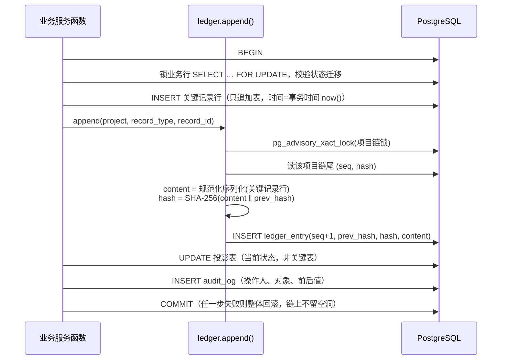

#### SEQ-F05-01 基线批量签认
覆盖：REQ-F05-02、AC-F05-03、AC-F05-04、AC-F05-05、AC-F01-10、AC-F16-02

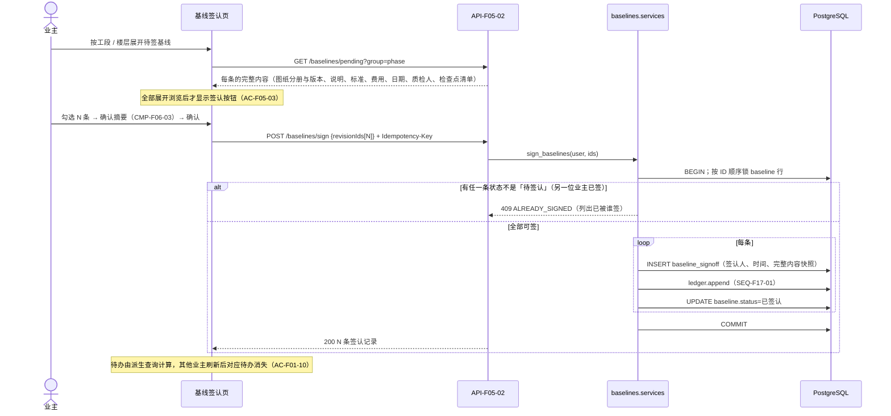

退回：`POST /baselines/{id}/return`，必填理由 → 追加 `baseline_event(returned, reason)` 并入链 → 状态改为「已退回」→ 项目经理待办里出现（AC-F05-05）。

#### SEQ-F04-01 图纸新版发布、签认与受影响基线待重签
覆盖：REQ-F04-01、REQ-F04-03、REQ-F04-04、REQ-F07-04、AC-F04-01~03、AC-F04-06、AC-F04-07、AC-F07-07

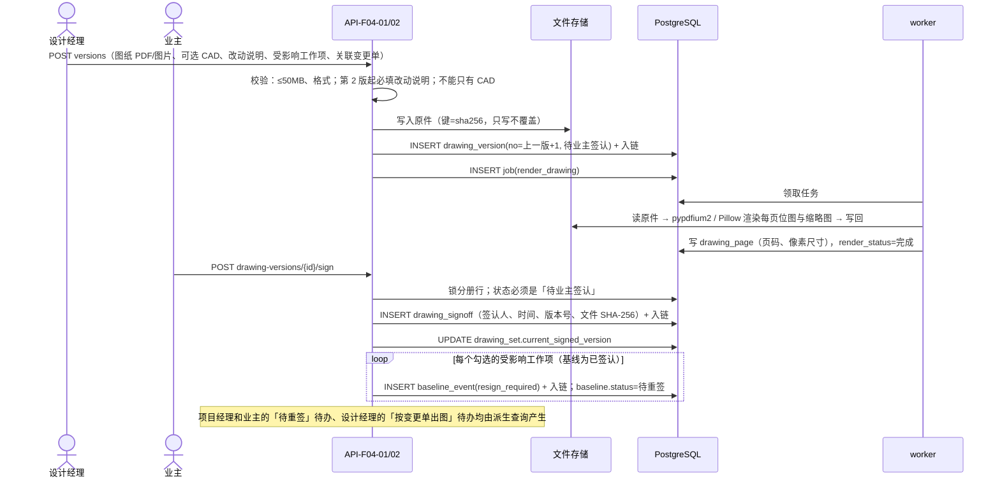

#### SEQ-F06-01 盖住前对图核对（含弱网重传与不一致生成问题）
覆盖：REQ-F06-02、REQ-F06-06、REQ-F08-01、REQ-F05-04、AC-F06-02~05、AC-F06-10、AC-F06-12、AC-F06-14、AC-F08-01、AC-F05-07、NFR-001、NFR-002

```mermaid
sequenceDiagram
  actor Q as 质检（手机）
  participant FE as 核对页 + CMP-F06-01
  participant IDB as 浏览器 IndexedDB
  participant API as API-F12-01 / API-F06-02
  participant DB as PostgreSQL
  Q->>FE: 打开检查点（底图=基线引用的签认版；待重签时顶部提示）
  Q->>FE: 拍照 ×k，选结论、覆盖状态
  FE->>IDB: 保存草稿与照片 Blob
  loop 每张照片
    FE->>API: POST /files（原图）
    alt 网络失败
      API--xFE: 超时 / 断开
      FE->>IDB: 标记待重传，显示「重传」
    else 成功
      API-->>FE: fileId + sha256
    end
  end
  Note over FE: k 张全部成功才允许提交
  Q->>FE: 提交
  FE->>API: POST /checkpoints/{id}/checks {fileIds, 结论, 已覆盖?, 变更单ID?}
  API->>DB: BEGIN；锁 checkpoint 行
  API->>API: 校验：≥1 张照片；「已变更」必须关联已生效变更单
  API->>DB: INSERT check_record（核对人、事务时间、所用图纸版本、照片与钉点、结论、覆盖状态、发现时点）+ 入链
  opt 选了「已被覆盖」且此前未放行
    API->>DB: INSERT cover_event(未放行先覆盖) + 入链；covered_at 取较早值
  end
  alt 结论=不一致
    API->>DB: INSERT issue(未闭环, 来源=该核对) + issue_event + 入链
    API->>DB: checkpoint.status = 已放行 ? 放行后发现不一致 : 不一致
  else 一致 / 已变更
    API->>DB: checkpoint.status=待放行；awaiting_release_since=now()
  end
  API->>DB: COMMIT
  API-->>FE: 201
  FE->>IDB: 清除草稿
```

发现时点（AC-F06-14）在服务端写入时计算：`核对日期(Asia/Shanghai) ≥ 交房日期(实际交房日期优先，否则计划交房日期)` 时为「交房后」；否则未覆盖为「覆盖前」，已覆盖为「覆盖后」。修正时追加 `discovery_correction` 并入链，指标取最新一次修正后的值（AC-F06-15）。

#### SEQ-F06-02 业主或代理人放行（含并发重复放行）
覆盖：REQ-F06-03、REQ-F01-05、REQ-F01-06、AC-F06-06~09、AC-F01-07、AC-F01-09、AC-F01-10、AC-F16-02、AC-F01-12、AC-F01-13（rev2：业主方成员未被指定为代理人、公司管理员均在角色判定处 403）

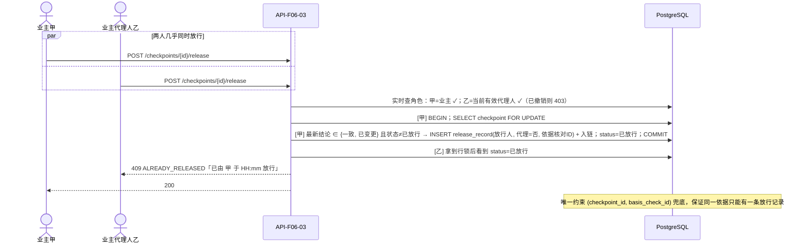

#### SEQ-F06-03 已签认基线新增检查点直接生效（rev2 新增）
覆盖：REQ-F06-01、REQ-F05-01、AC-F06-16、AC-F05-10、AC-F06-01、AC-F05-06、AC-F16-01。取代原页面决策 DEC-210「新检查点并入重签稿」（已作废，见 PAGE-F05-01 §12）。

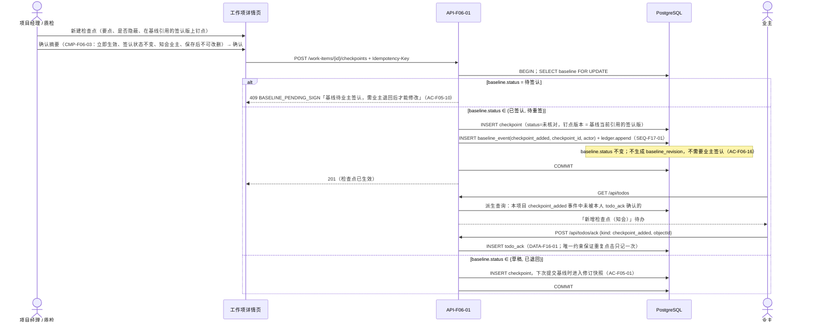

已有检查点的定义字段（要点、是否隐蔽、钉点版本与坐标）没有修改和删除接口；新增后的检查点同样如此（AC-F06-16「已有检查点仍不可修改或删除」、AC-F05-06）。下一次重签时，`baseline_revision.content` 快照自然包含新增的检查点。

#### SEQ-F07-01 变更单：发起 → 定价 → 业主签认 → 驳回后重新提交
覆盖：REQ-F07-01~05、AC-F07-01~09、AC-F13-02、AC-F08-02、AC-F16-01（rev2 增加 AC-F07-09 分支）

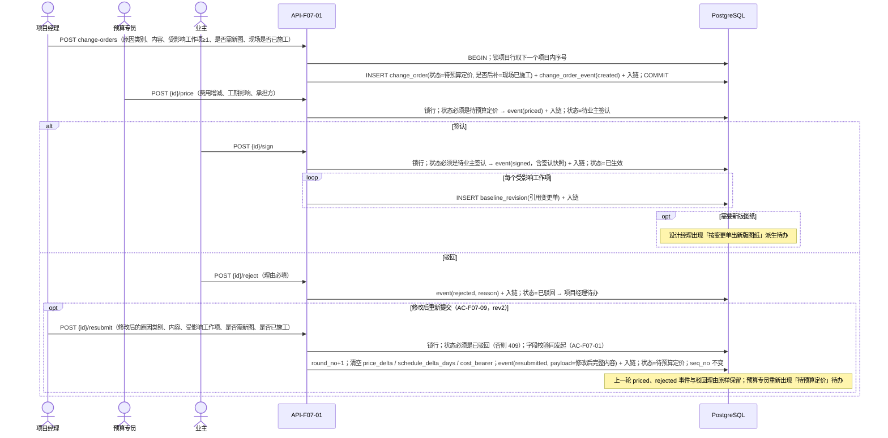

#### SEQ-F17-02 证据包导出
覆盖：REQ-F17-03、AC-F17-04、AC-F17-05、NFR-002

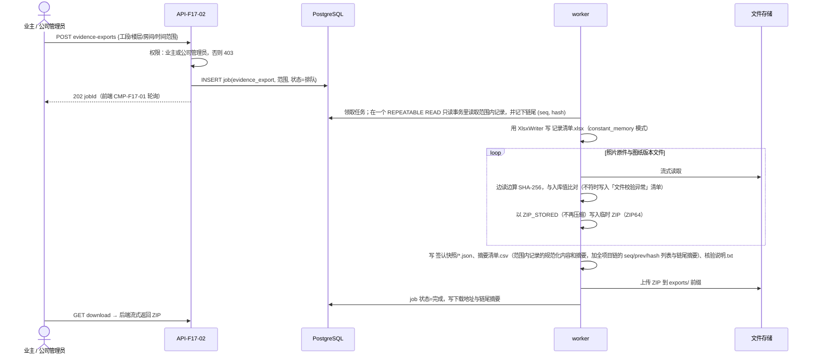

证据包可以离线核验：摘要清单附带范围内每条记录的规范化内容，任何 SHA-256 工具都能按「内容 ‖ 前一条摘要」重算；全链 seq/hash 列表用来证明范围外记录没有被插入或删除。业主自己保存的链尾摘要还能识别「末尾记录被整体截断」——这是库内校验无法发现的一类篡改（AC-F17-04、PRD §7.1）。

#### SEQ-F17-03 完整性校验
覆盖：REQ-F17-02、AC-F17-03、NFR-004、NFR-005

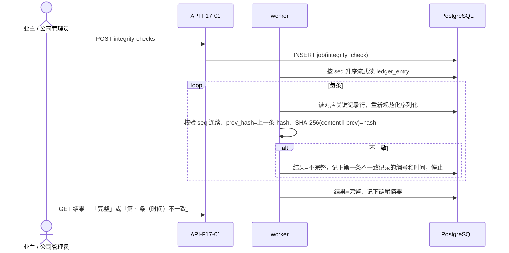

#### SEQ-F02-01 登录、锁定与强制改密
覆盖：REQ-F02-02、REQ-F02-03、AC-F02-05~07、NFR-006

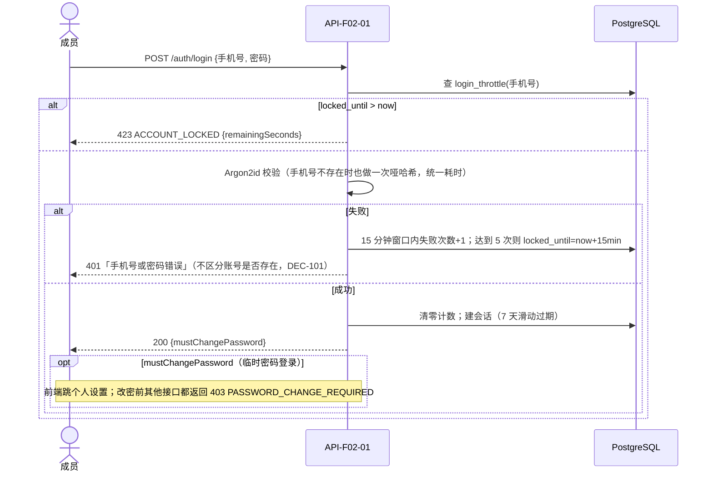

临时密码的产生（API-F02-03，NFR-006 rev2）：公司管理员确认重置 → 服务端生成临时密码，只存 Argon2id 哈希并置 `must_change_password=true` → 明文只出现在这一次响应体里（`Cache-Control: no-store`），前端只在重置结果弹窗显示，关闭即丢弃，不写入 react-query 缓存或本机存储 → `audit_log` 只记「谁在何时重置了谁」，不含临时密码。之后任何接口都不能再取回明文。

#### SEQ-F03-01 Excel / CSV 计划导入（校验 → 执行）
覆盖：REQ-F03-04、REQ-F03-05、AC-F03-07~10

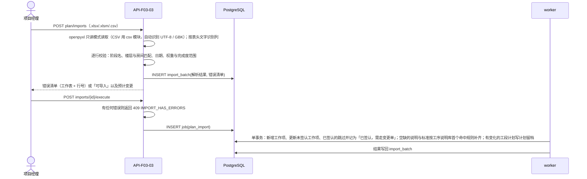

原型 JSON 导入（API-F18-01）复用同一个「校验 → 单事务执行」模式：只允许筹备中的项目；导入的工作事项、问题、出勤、留档、补充事项、留言、验收图片都带 `source='prototype_import'`；只有元数据的文件建为 `stored_file.status=missing`（「文件缺失，需重新上传」）；**不生成**任何签认、核对或放行记录（AC-F18-01~03）。验收图片的 Base64 内容解码后作为文件写入存储。

### 4.8 风险
- 风险 1：Python 单进程的 CPU 密集任务（PDF 渲染、ZIP 打包）拖慢在线请求。→ 缓解：这些任务全部放在独立的 worker 容器里，与 web 容器分开限制 CPU；web 只做 I/O。
- 风险 2：权限点和角色矩阵分散在各视图里，容易漏。→ 缓解：权限矩阵集中在一个模块；用测试遍历全部路由，断言每个路由都声明了权限点（NFR-003）。
- 风险 3：业务服务函数漏写操作日志（AC-F17-06）。→ 缓解：日志写入封装在服务层基类的统一写入口里；测试遍历全部写接口，断言各自产生日志。

---

## 5. 数据层选型

### 5.1 主数据库

#### 5.1.1 候选与推荐

| 候选 | DX | Perf | Eco | AI | Scale | Learn | TCO | 加权总分 |
| :--- | :---: | :---: | :---: | :---: | :---: | :---: | :---: | :---: |
| PostgreSQL 18 | 5 | 4 | 5 | 5 | 4 | 4 | 5 | **4.75** |
| MySQL 8.4 LTS | 4 | 4 | 5 | 5 | 4 | 5 | 5 | 4.65 |

**推荐：PostgreSQL 18（单实例，同一台服务器上的容器）**。官方版本表显示 18 当前小版本为 18.6，支持到 2030-11-14；Django 5.2 文档要求 PostgreSQL 14 及以上。

推荐理由：
1. 实现本方案需要的几项能力在 PostgreSQL 里都是原生的：事务级咨询锁 `pg_advisory_xact_lock`（按项目串行化摘要链，SEQ-F17-01）；部分唯一索引（「每个项目最多一名有效代理人」AC-F01-08、「每个检查点同一依据只有一条放行」AC-F06-09）；按表授予 INSERT/SELECT 并 REVOKE UPDATE/DELETE/TRUNCATE（NFR-004）；`jsonb` 存签认内容快照；`timestamptz` 加时区计算（NFR-008）。MySQL 没有部分索引，要用生成列绕过。
2. Django 对 PostgreSQL 的支持最完整，例如约束条件与 `select_for_update(skip_locked=True)`。

**不采用云厂商托管数据库（RDS）**：蓝图只确认了服务器、域名、备案和对象存储，托管数据库属于新增付费资源（铁律 8 依赖门禁）。单项目规模下，同机容器加每日备份已满足 NFR-005。升级触发条件：并发或数据量超出单机能力，或者公司要求 RPO 小于 24 小时，这时回到蓝图阶段确认是否采购 RDS。

#### 5.1.2 数据模型（DATA）

可变性：**A** = 只追加的关键表（运行账号只有 INSERT/SELECT，记录入摘要链）；**A′** = 只追加但不入链（操作日志）；**M** = 可变表；**P** = 投影表（可变，保存当前状态，可以由 A 表的事件重新推导）。所有项目内的表都带 `project_id`（非空，加索引）。

| DATA ID | 实体（表） | 关键字段 | 关键约束 / 状态字段 | 可变性 | 覆盖 |
| :--- | :--- | :--- | :--- | :--- | :--- |
| DATA-F01-01 | 公司 `company` | id、name | 单公司部署时只有 1 行 | M | 蓝图 §4 不可逆约束 |
| DATA-F01-02 | 项目 `project` | company_id、name、address、planned_start、planned_handover、actual_handover、status、release_timeout_hours(默认 24)、change_order_seq、template_id | `company_id` 非空；`planned_handover ≥ planned_start`；status ∈ {筹备, 施工中, 已交房}；已交房要求 actual_handover 非空；`release_timeout_hours` 取 1–72 | M | REQ-F01-01、REQ-F01-07、AC-F01-01、AC-F01-02、AC-F01-11、AC-F06-13 |
| DATA-F01-03 | 项目成员角色 `project_member_role` | project_id、user_id、role、granted_by、granted_at | 唯一 (project, user, role)；role ∈ {owner, owner_member, owner_agent, pm, design_manager, qc, budget}（`owner_member` 即业主方成员，rev2 AC-F01-03、AC-F01-12；公司管理员不在此表，见 `user.is_company_admin`）；部分唯一索引 `(project) WHERE role='owner_agent'`；移除成员 = 删除该成员在本项目的角色行（不是关键记录；变化写入操作日志） | M | REQ-F01-02、REQ-F01-04~06、AC-F01-03、AC-F01-06~10、AC-F01-12 |
| DATA-F02-01 | 用户 `user` | phone(唯一)、name、password(argon2)、is_company_admin、must_change_password、is_active | 手机号 11 位唯一；姓名用于全站署名；历史记录引用 user_id，所以移除成员不影响署名 | M | REQ-F02-01~04、AC-F01-06、NFR-006 |
| DATA-F02-02 | 邀请 `invitation` | project_id、phone、roles[]、token_hash、expires_at、used_at、revoked_at、created_by | 只存令牌的 SHA-256；有效 = 未用、未撤销、未过期（7 天）；接受时 `UPDATE … WHERE used_at IS NULL` 原子占用；`created_by` 为业主时 roles 只能是 `[owner_member]`（AC-F02-09） | M | REQ-F02-01、AC-F02-01~04、AC-F02-09 |
| DATA-F02-03 | 登录限流 `login_throttle` | phone、fail_count、window_start、locked_until | 按手机号计数，不要求账号存在（避免借此探测手机号） | M | AC-F02-06 |
| DATA-F02-04 | 会话 `django_session` | session_key、data、expire_date | Django 内置；7 天滑动过期；改密或重置后旧会话的认证哈希失效 | M | AC-F02-05、AC-F02-08 |
| DATA-F03-01 | 公司模板 `template` / `template_node` | 模板树：工段、楼层、房间、工作项、检查点模板 | 创建项目时**深拷贝**到项目表，不保留引用，所以改模板不影响已有项目 | M | REQ-F03-01、AC-F03-01、AC-F01-01 |
| DATA-F03-02 | 工序说明规则 `process_rule` | order_no、match_pattern、work_description、acceptance_criteria、is_active | 按 order_no 取首个命中的规则 | M | REQ-F03-05、AC-F03-10 |
| DATA-F03-03 | 楼层 / 房间 `floor` / `room` | name、order_no、is_disabled；room.floor_id | 有引用时只能停用 | M | REQ-F03-02、AC-F03-02、AC-F03-03 |
| DATA-F03-04 | 工段 `phase` | name、color、order_no、planned_start/end、actual_start/end、team_lead、weight、scope_note、is_disabled | `planned_start ≤ planned_end`；状态与进度不存储，实时推导（AC-F03-06） | M | REQ-F03-02、REQ-F03-03、AC-F03-05、AC-F03-06、AC-F14-03 |
| DATA-F03-05 | 工作项 `work_item` | phase_id、floor_id、room_id、name、description、acceptance_criteria、cost、planned_finish、actual_finish、owner_name、qc_user_id、drawing_version_id、weight(1–5)、progress(0–100)、source、is_disabled | room 必须属于 floor（服务层校验，外加复合外键 (room_id, floor_id)）；基线状态为待签认 / 已签认 / 待重签时，锁定字段由服务层拒绝修改 | M | REQ-F03-03、REQ-F05-03、AC-F03-04、AC-F05-06 |
| DATA-F03-06 | 导入批次 `import_batch` | kind(plan_xlsx / plan_csv / prototype_json)、file_id、parsed、errors、result、status | — | M | AC-F03-08、AC-F03-09、AC-F18-01 |
| DATA-F04-01 | 图纸分册 `drawing_set` | name、current_signed_version_id | 投影：当前签认版 | P | REQ-F04-03、AC-F04-06 |
| DATA-F04-02 | 图纸版本 `drawing_version` | set_id、version_no、file_id、cad_file_id、change_note、affected_work_item_ids[]、change_order_id、status_at_create、created_by、created_at | 唯一 (set_id, version_no)；version_no = 上一版 + 1（锁分册行后分配）；第 2 版起 change_note 非空 | **A** | REQ-F04-01、REQ-F04-02、AC-F04-01~04 |
| DATA-F04-03 | 图纸签认 `drawing_signoff` | version_id、signer_id、signed_at、version_no、file_sha256 | 唯一 (version_id) | **A** | REQ-F04-03、AC-F04-06、AC-F01-10 |
| DATA-F04-04 | 图纸页位图 `drawing_page` | version_id、page_no、image_file_id、thumb_file_id、width_px、height_px；version 级 render_status | 派生数据，可以从原件重新生成 | M | AC-F04-05、AC-F04-08、AC-F06-01 |
| DATA-F05-01 | 基线 `baseline` | work_item_id(唯一)、status、current_revision_id、signed_revision_id、return_reason | status ∈ {草稿, 待签认, 已签认, 已退回, 待重签}（§5.1.5） | P | REQ-F05-01~04、AC-F05-05、AC-F05-07、AC-F05-08 |
| DATA-F05-02 | 基线修订 `baseline_revision` | baseline_id、rev_no、kind(submit / change_order)、content(jsonb 快照：图纸分册与版本、说明、标准、费用、计划日期、质检人、检查点清单)、change_order_id | 唯一 (baseline_id, rev_no) | **A** | AC-F05-01、AC-F05-04、AC-F05-08、AC-F07-04 |
| DATA-F05-03 | 基线签认 `baseline_signoff` | revision_id、signer_id、signed_at、content_snapshot | 唯一 (revision_id) | **A** | REQ-F05-02、AC-F05-04、AC-F05-08 |
| DATA-F05-04 | 基线事件 `baseline_event` | baseline_id、kind(submitted / returned / resign_required / checkpoint_added)、reason、drawing_version_id、checkpoint_id、actor_id、at | `checkpoint_added` 只在基线已签认或待重签时写入，是「新增检查点」的留痕，也是业主知会待办的来源（rev2） | **A** | AC-F05-05、AC-F04-07、AC-F06-16 |
| DATA-F06-01 | 检查点 `checkpoint` | work_item_id、code、point、is_concealed、drawing_version_id、page_no、x、y、status、latest_check_id、awaiting_release_since、released_at、covered_at、unreleased_cover | x、y ∈ [0,1]；status 见 §5.1.5；定义字段（point、is_concealed、drawing_version_id、page_no、x、y）创建后无修改、删除接口（AC-F06-16）；`covered_at` = 首次标记覆盖与首次「核对时已覆盖」两者中较早的时间（PRD §3.2.1） | P | REQ-F06-01、REQ-F06-04、AC-F06-01、AC-F06-11、AC-F06-13、AC-F06-16 |
| DATA-F06-02 | 核对记录 `check_record` | checkpoint_id、checker_id、checked_at、drawing_version_id、was_latest_signed、conclusion、was_covered、change_order_id、discovery_phase | conclusion ∈ {一致, 不一致, 已变更}；已变更时 change_order_id 指向已生效的变更单；`was_latest_signed` 在写入时计算并固化（AC-F10-06） | **A** | REQ-F06-02、AC-F06-03~05、AC-F06-14、AC-F10-06 |
| DATA-F06-03 | 核对照片 `check_photo` | check_id、file_id、file_sha256、pin_x、pin_y | 每条核对至少 1 张 | **A**（随核对一起入链） | AC-F06-02、AC-F06-03 |
| DATA-F06-04 | 放行记录 `release_record` | checkpoint_id、releaser_id、is_proxy、released_at、basis_check_id | 唯一 (checkpoint_id, basis_check_id) | **A** | REQ-F06-03、AC-F06-06、AC-F06-09、AC-F01-09 |
| DATA-F06-05 | 覆盖事件 `cover_event` | checkpoint_id、source(pm_mark / qc_check)、recorder_id、at、was_unreleased | was_unreleased=true 即「未放行先覆盖」事件 | **A** | AC-F06-12、AC-F10-05 |
| DATA-F06-06 | 发现时点修正 `discovery_correction` | check_id、before、after、reason、actor_id、at | reason 非空 | **A** | AC-F06-15 |
| DATA-F07-01 | 变更单 `change_order` | seq_no、round_no(默认 1)、reason_category、content、needs_new_drawing、built_before_sign(=后补)、status、price_delta、schedule_delta_days、cost_bearer、reject_reason；关联 `change_order_item`(work_item_id)、`change_order_file` | 唯一 (project, seq_no)；status ∈ {草稿, 待预算定价, 待业主签认, 已生效, 已驳回}（草稿只用于「从问题 / 补充事项生成」）；重新提交时 seq_no 不变、round_no+1（AC-F07-09） | P | REQ-F07-01~05、AC-F07-01~09、AC-F13-02 |
| DATA-F07-02 | 变更单事件 `change_order_event` | change_order_id、round_no、kind(created / priced / signed / rejected / resubmitted)、payload(jsonb，签认与重新提交时含内容快照)、actor_id、at | 每一轮每种 kind 最多一条：唯一 (change_order_id, round_no, kind)（rev2：原「每单每种 kind 一条」会阻止重新提交后的再次定价与驳回） | **A** | AC-F07-02~06、AC-F07-09、AC-F17-01 |
| DATA-F08-01 | 问题 `issue` | source_check_id、checkpoint_id、work_item_id、phase/floor/room、description、level、countermeasure、owner、due_date、cause、status、closed_on、void_reason、source | status ∈ {未闭环, 处理中, 已闭环, 已作废}；超期天数实时计算 | P | REQ-F08-01~04、AC-F08-01~07 |
| DATA-F08-02 | 问题状态变化 `issue_event` | issue_id、kind(created / cause_set / closed / reopened / voided)、before、after、reason、actor_id、at | — | **A** | AC-F08-05、AC-F08-07、AC-F17-01 |
| DATA-F09-01 | 经验条目 `experience_entry` | company_id、current_version_id、status(待审核 / 未验证经验 / 历史观察 / 已验证)、reviewer_id、reviewed_at、source_issue_id | 公司级，不带 project_id；内容由服务端白名单字段生成（脱敏） | P | REQ-F09-01、REQ-F09-02、AC-F09-01、AC-F09-02 |
| DATA-F09-02 | 经验条目版本 `experience_version` | entry_id、ver_no、phase_name、process、issue_type、check_point、countermeasure、photo_file_ids、status、author_id、at | 唯一 (entry_id, ver_no)；只追加 | A′ | AC-F09-03、AC-F09-04 |
| DATA-F11-01 | 出勤 `attendance` | phase_id、date、headcount(0–40)、source | 唯一 (phase_id, date)；未登记日期不存行 | M | REQ-F11-01、AC-F11-01~04 |
| DATA-F12-01 | 文件对象 `stored_file` | storage_key、sha256、size、mime、original_name、uploader_id、status(normal / voided / missing)、thumb_key | 存储键带内容哈希，只写不覆盖；被关键记录引用的文件不能作废 | M | AC-F12-01~03、AC-F18-02 |
| DATA-F12-02 | 工作项资料 `work_item_attachment` | work_item_id、file_id、voided_by、voided_at | 作废 = 状态标记，不删除 | M | REQ-F12-01、AC-F12-01、AC-F12-03 |
| DATA-F12-03 | 验收图片 `acceptance_photo` | phase_id、file_id、caption、status(施工中 / 待复验 / 已验收)、source | 新上传默认「待复验」 | M | REQ-F12-02、AC-F12-04 |
| DATA-F12-04 | 档案分类与资料 `archive_folder` / `archive_file` | zone(layout / render / contract)、name；file_id | 只能删空分类 | M | REQ-F12-03、AC-F12-05、AC-F12-06 |
| DATA-F13-01 | 补充事项 `supplement` | title、note、raised_on、due_on、owner、status、change_order_id、source | status 在「待处理 → 处理中 → 已完成」之间切换 | M | REQ-F13-01、AC-F13-01、AC-F13-02 |
| DATA-F13-02 | 留言 `notice` | board(owner / site / design)、author_id、parent_id、body、deleted_at、source | 按发布者角色归入板块；删除 = 软删除，显示占位 | M | REQ-F13-02、AC-F13-03、AC-F13-04 |
| DATA-F14-01 | 计划留档 `plan_change_log` | phase_id、at、changes(jsonb：字段、前值、后值)、duration_delta_days、reason、source | 只在有字段变化时写入 | **A** | REQ-F14-01、AC-F14-01、AC-F14-02、AC-F14-04 |
| DATA-F15-01 | 付款节点 `payment_milestone` | name、amount、planned_on、phase_id、status(未付 / 已付)、paid_confirmed_unreleased | 标记已付写入操作日志 | M | REQ-F15-01、REQ-F15-02、AC-F15-01~03 |
| DATA-F16-01 | 知会确认 `todo_ack` | user_id、project_id、kind(checkpoint_added)、object_id(baseline_event.id)、acked_at | 唯一 (user_id, kind, object_id)；多名业主各自确认 | M（rev2，design-derived：知会待办需要「知道了」后消失，PAGE-F16-01 DEC-118） | AC-F06-16、AC-F16-02 |
| DATA-F17-01 | 摘要链 `ledger_entry` | project_id、seq、record_type、record_id、content(规范化 JSON 文本)、prev_hash、hash、created_at | 唯一 (project_id, seq)；唯一 (record_type, record_id)；首条 prev_hash = 64 个 0 | **A** | REQ-F17-02、AC-F17-02、AC-F17-03、NFR-004 |
| DATA-F17-02 | 操作日志 `audit_log` | project_id、actor_id、at、action、object_type、object_id、before(jsonb)、after(jsonb)、request_id | 索引 (project_id, at)、(object_type, object_id)；密码类字段一律不写，包括重置产生的临时密码（NFR-006 rev2） | A′ | REQ-F17-04、AC-F17-06、AC-F01-08、AC-F02-07、NFR-006 |
| DATA-F17-03 | 后台任务 `job` | kind、project_id、params、status(排队 / 运行 / 完成 / 失败)、progress、result、error、created_by、timestamps | 领取时用 `FOR UPDATE SKIP LOCKED` | M（design-derived：证据包、校验、渲染、导入需要异步执行） | AC-F17-03、AC-F17-04、NFR-002 |
| DATA-F18-01 | 数据来源标记（字段，不单独建表） | 被导入的表都带 `source ∈ {manual, excel_import, prototype_import}` | 原型导入不写入任何 A 类签认、核对或放行表 | — | REQ-F18-01、AC-F18-01、AC-F18-02 |

待办（F16）没有独立的待办表：由派生查询按角色实时计算（§5.1.6）；唯一例外是知会类待办的「知道了」确认记录 DATA-F16-01。

核心关系（简化）：

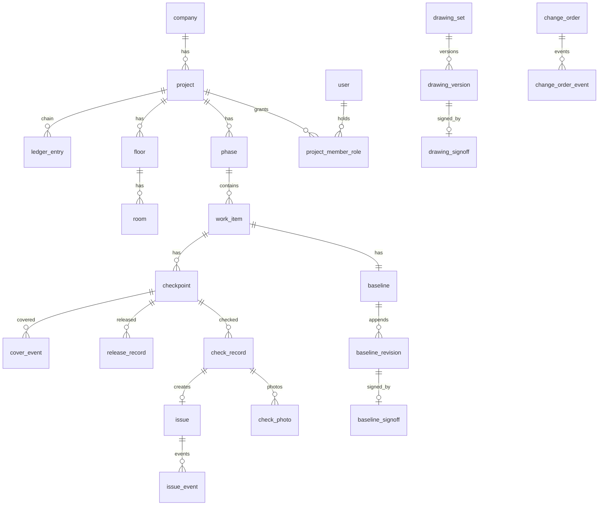

#### 5.1.3 关键记录只追加与摘要链（NFR-004）

- **入链范围**：PRD §3.2.1 列出的关键记录全部入链：基线签认、图纸签认、变更单签认与状态、核对、放行、图纸版本、问题状态变化、计划留档、发现时点修正。另外，基线修订、基线退回或待重签事件、覆盖事件也入链（AI 决策，理由：这几项同样决定证据链指标和基线状态，放在链外就可能被单独篡改；这不改变任何用户可见行为）。
- **链的粒度**：**每个项目一条链**。这样证据包和完整性校验都以项目为单位，不受其他项目影响；也只需按项目串行化写入，不同项目可以并发。
- **规范化序列化**：各记录类型有固定的字段白名单，输出 UTF-8 JSON，键按字典序排列，无多余空白；时间统一为 UTC ISO 8601 微秒精度；金额为字符串；引用的文件用其 SHA-256 表示。`hash = SHA-256(content_bytes ‖ prev_hash_hex)`，与 AC-F17-02「内容 + 上一条摘要」的顺序一致。规范化格式写成版本号常量（`canon_v1`）；格式以后有变化时只对新记录使用新版本，旧记录照旧可以校验。
- **数据库授权**（写进迁移里的 `RunSQL`）：建两个数据库角色：`app_owner` 拥有表、只给迁移使用；`app_runtime` 给 web 和 worker 使用。对全部 A / A′ 表：`REVOKE UPDATE, DELETE, TRUNCATE … FROM app_runtime; GRANT SELECT, INSERT …`。每次迁移结束后跑一个自检，查询 `information_schema.role_table_grants`，确认运行账号对这些表没有 UPDATE / DELETE 权限，否则部署失败。
- **文件不可篡改**：存储键带 SHA-256；应用只调用 Put / Get / Head / List，从不覆盖或删除对象。建议公司在云账号里给系统使用的访问密钥只授予这几个动作（不给 Delete 权限）。这是部署时对已有 deployment-secret 的配置要求，不是新资源。

#### 5.1.4 并发与一致性
- 同一业务对象的状态迁移一律先 `SELECT … FOR UPDATE` 锁住投影行，再校验当前状态。重复操作得到 409 和原记录信息（AC-F06-09、AC-F01-10）。
- 唯一约束兜底：`release_record(checkpoint_id, basis_check_id)`、`baseline_signoff(revision_id)`、`drawing_signoff(version_id)`、`change_order_event` 的唯一约束 (change_order_id, round_no, kind)、`drawing_version(set_id, version_no)`、`change_order(project_id, seq_no)`。
- 摘要链：事务内用 `pg_advisory_xact_lock(项目链锁)` 串行化；锁随事务提交或回滚自动释放，链上不会出现空洞或分叉。
- 批量签认需要锁多行时按 ID 升序加锁，避免死锁。

#### 5.1.5 状态迁移

**检查点 `checkpoint.status`**（DATA-F06-01；REQ-F06-02~04）

| 当前 | 事件 | 新状态 | 约束 |
| :--- | :--- | :--- | :--- |
| 未核对 | 核对=一致 / 已变更 | 待放行 | 已变更必须关联已生效变更单（AC-F06-04） |
| 未核对 | 核对=不一致 | 不一致 | 生成问题（AC-F08-01） |
| 不一致 | 复核=一致 / 已变更 | 待放行 | 追加新核对，旧的保留（AC-F06-05） |
| 不一致 | 复核=不一致 | 不一致 | 再追加一条核对；问题保持未闭环 |
| 待放行 | 放行 | 已放行 | 只有业主或代理人（AC-F06-06、AC-F06-08） |
| 待放行 | 复核=不一致 | 不一致 | — |
| 已放行 | 核对=不一致 | 放行后发现不一致 | 保留原放行记录（AC-F06-10） |
| 放行后发现不一致 | 复核=一致 / 已变更 | 待放行 | 再次放行时依据新的核对记录 |
| **非法迁移** | 未核对 / 不一致 / 放行后发现不一致 → 放行 | 拒绝 | 422（AC-F06-07） |
| **非法迁移** | 已放行 → 放行 | 拒绝 | 409（AC-F06-09） |

**新建检查点**（AC-F06-16，rev2，SEQ-F06-03）：基线已签认 / 待重签时新建 → 直接以「未核对」生效，基线状态不变，追加 `baseline_event(checkpoint_added)`；基线待签认时新建 → 拒绝 409（AC-F05-10）；基线草稿 / 已退回时新建 → 进入编辑稿。检查点没有「删除」或「修改定义」迁移。

「不得覆盖」「超时」是派生标签，不是状态：隐蔽检查点且 status≠已放行时显示「不得覆盖」（AC-F06-11）；status=待放行且 `now − awaiting_release_since > release_timeout_hours` 时显示「超时」（AC-F06-13）。覆盖标记独立于状态：标记已覆盖时，若 status≠已放行就写入 `cover_event(was_unreleased=true)`（AC-F06-12）。

**基线 `baseline.status`**（DATA-F05-01；REQ-F05-01~04）：草稿 →(提交，字段齐全)→ 待签认 →(签认)→ 已签认 / →(退回，带理由)→ 已退回 →(修改后再提交)→ 待签认；已签认 →(受影响新版图纸被签认)→ 待重签 →(更新版本后提交并签认)→ 已签认，保留旧的签认记录；已签认 →(变更单生效)→ 已签认，追加修订。非法：草稿或已退回直接签认；已签认再提交；**待签认期间任何修改（含新增检查点）→ 409 `BASELINE_PENDING_SIGN`，只能由业主退回后再改（AC-F05-10，rev2）**；待重签期间改锁定字段以外的内容不受限制。已签认 / 待重签期间新增检查点不改变状态（AC-F06-16）。并发：多位业主同时签认，先拿到行锁的一方生效，另一方收到 409。

**变更单 `change_order.status`**（DATA-F07-01；REQ-F07-01~03）：草稿 →(补齐字段后提交)→ 待预算定价 →(定价)→ 待业主签认 →(签认)→ 已生效 / →(驳回，带理由)→ 已驳回。已驳回 →(项目经理修改后重新提交)→ 待预算定价，编号 seq_no 不变、round_no+1，上一轮定价清空，原驳回事件与理由保留（AC-F07-09，rev2）。非法：跳过定价直接签认；对已生效或已驳回的单再签认或驳回（409）；对非「已驳回」的单重新提交（409）；已生效单不能重新提交。并发：同一张已驳回单被重复提交，先拿到行锁的一次生效，另一次 409。

**图纸版本**（DATA-F04-02/03）：待业主签认 →(签认)→ 已签认；同一分册签认新版后，旧版的「当前签认版」身份转给新版，旧版只读可查。非法：删除、替换（405，AC-F04-04）。

**问题 `issue.status`**（DATA-F08-01）：未闭环 →(闭环)→ 已闭环 →(重开)→ 处理中 →(闭环)→ 已闭环；未闭环或处理中 →(作废，带理由)→ 已作废（终态）。不一致问题闭环前，检查点最新结论必须是一致或已变更（AC-F08-06）。

**项目 `project.status`**（DATA-F01-02）：筹备 → 施工中 → 已交房（必须填写实际交房日期）。不允许倒退。原型 JSON 导入只允许在「筹备」状态。

**邀请**：有效 →(接受)→ 已使用 / →(撤销)→ 已撤销 / →(过期)→ 已过期（过期按读取时间判断）。**经验条目**：待审核 →(审核)→ 未验证经验 / 历史观察 / 已验证，之后每次修改生成新版本。**补充事项**：待处理 → 处理中 → 已完成。**验收图片**：施工中 → 待复验 → 已验收，循环切换。**付款节点**：未付 → 已付（仍有未放行检查点时需二次确认）。

#### 5.1.6 计算口径与性能、容量（NFR-002、NFR-009）

- **指标集中实现**：`progress/metrics.py` 一个模块，用 SQL 聚合计算：
  - 工段进度 = Σ(w×p)/Σw，保留 1 位小数，没有工作项时为 0；状态阈值为 0 和 99.95（AC-F03-05、AC-F03-06）。
  - 总体完成度、计划基准按工段权重加权；工期按自然日含首尾计算（AC-F10-01、AC-F10-02）。
  - 覆盖前发现比例：分母 = 未作废问题对应的不一致核对，取修正后的发现时点（AC-F10-04）。
  - 隐蔽检查点合规率：分母 = 已放行或已覆盖的隐蔽检查点，覆盖时间取 `covered_at`，从未标记覆盖的取放行时间；分子 = 覆盖时间之前同时具备「引用签认版的核对 + ≥1 张照片 + 放行记录」（AC-F10-05、RA-006）。
  - 最新签认版使用率：取 `check_record.was_latest_signed`（AC-F10-06）。
  - 变更先签后做比例：已生效且非后补的变更单 / 已生效变更单（AC-F10-07）。
  - 任一指标分母为 0 时返回 `null`，前端显示「暂无数据」（AC-F10-08）。
- **待办派生查询**（API-F16-01）：每类待办一条带索引的查询（如：业主的待放行 = `checkpoint.status='待放行' AND project ∈ 我是 owner/agent 的项目`），各类用 UNION 汇总后按「超时」优先排序。数据量为「我的项目 × 待处理状态」，很小。
- **关键索引**：`checkpoint(project_id, status)`、`checkpoint(project_id, work_item_id)`、`check_record(checkpoint_id, checked_at DESC)`、`check_photo(check_id)`、`issue(project_id, status, due_date)`、`baseline(status)` 加 `work_item(project_id, phase_id, floor_id, room_id)`、`change_order(project_id, status)`、`audit_log(project_id, at)`、`ledger_entry(project_id, seq)`、`attendance(phase_id, date)`。
- **容量估算**（单项目，NFR-009）：业务行约 10 万级，链条目约 3–5 万条，照片 20000 张（每张约 3–8MB，共约 60–160GB，存在对象存储）。PostgreSQL 单库远未到瓶颈；列表一律分页，照片列表只返回缩略图地址（缩略图约 30KB）。
- **不需要缓存**：总览的聚合查询在上述规模下预计能达到百毫秒级；压测不达标时，先加索引或物化视图，仍不够再考虑缓存（升级触发条件）。

### 5.2 缓存层
不激活。理由：20 并发、单库，聚合查询有索引支撑，引入 Redis 只会多一个需要运维和备份的组件（铁律 8）。升级触发条件：压测中总览或待办接口 P95 超过 1 秒，且优化索引和查询之后仍超标。

### 5.3 搜索引擎
不激活。列表筛选按结构化字段进行；问题台账、经验库的文本搜索用 PostgreSQL `ILIKE`，数据量不过万。

---

## 6. AI 能力选型

不适用：本期无 AI 能力（PRD §0「明确不做 AI 识图或识别变更」，§10.3 解法路线为「规则 + 证据链，第一版不用 AI」）。

---

## 7. 基础设施选型

### 7.1 部署与托管（直接默认：继承蓝图 §8 已确认决策）

- **推荐**：在装修公司采购的国内公有云服务器上，用 Docker Compose 单机编排 5 个容器：`nginx`、`web`、`worker`、`postgres`、`backup`。数据库数据目录、本地文件目录（降级模式）、备份目录都挂在宿主机的数据盘上。
- **决策证据**：蓝图 §8「前后端分离的单体应用，单实例部署在国内公有云服务器（容器化）」；D-9 由公司负责云资源，AI 负责部署脚本；用户规模为单公司、20 并发。
- **当前代价**：单点，服务器故障期间不可用，恢复依赖每日备份（RPO ≤ 24 小时）；升级发布时有短暂中断（目标 1 分钟以内，安排在非施工时段）。
- **升级触发条件**：同时在建工地多到单机 CPU 或内存长期超过 70%，或公司提出高可用要求时，再评估拆分数据库或做多实例（多实例时必须用对象存储，不能用本地目录）。
- **服务器规格建议**（属于已确认的服务器采购，不是新增资源）：4 vCPU / 8 GiB 内存；系统盘 40GB；数据盘 ≥ 100GB（数据库、证据包临时文件、本地备份；降级为本地文件存储时按照片总量另行扩容）；公网出带宽 ≥ 10Mbps（可以按流量计费）。服务器与对象存储放在同一地域，走内网端点，满足证据包 5 分钟的要求。
- **容器镜像在国内的获取**：Docker Hub 在国内不能稳定访问。基础镜像（`python:3.13-slim`、`postgres:18`、`nginx:1.30`、`node:24`，其中 node 只用于构建阶段）通过所选云厂商为本厂服务器提供的 Docker Hub 镜像加速地址拉取；如果加速不可用，就在能访问的构建机上 `docker build` 后用 `docker save` / `docker load` 离线传到服务器。两种方式都不需要新的平台账号。
- **域名与备案**：ICP 备案完成前，用服务器公网 IP 或临时地址供项目成员内测（Capability prerequisites 回退方案）；备案完成后切换到正式域名，并启用 HTTPS。
- **HTTPS 证书（rev2 前置能力，已决：用户 2026-10-27）**：使用所选云厂商为已备案域名提供的免费 DV 证书，由公司管理员在同一个云账号里申请，不新增平台账号。证书与私钥作为部署文件放在服务器 `/etc/nginx/certs/`（权限 600，不进代码仓库），Nginx 终止 TLS，HTTP 一律 301 到 HTTPS，HSTS 在正式域名稳定后开启。免费证书有效期以云厂商当期规则为准（近年普遍较短），续签方式：公司管理员在云控制台续签并下载 → 运行部署脚本 `deploy cert` 替换文件并 `nginx -s reload`，不中断服务。到期提醒：备份容器每日检查证书剩余天数，少于 15 天写 WARN 日志并在审计页任务状态中提示。备案与证书完成前，按前置能力回退方案只用临时地址供项目成员内测（该阶段会话 Cookie 的 `Secure` 标志无法生效，属于已接受的内测限制，正式上线前必须切到 HTTPS）。
- **Nginx**：托管前端静态文件（带哈希文件名的资源长缓存，`index.html` 不缓存）；把 `/api` 反向代理到 web；`client_max_body_size 55m`；本地文件驱动时用 `X-Accel-Redirect` 内部位置直接发送文件；加上 HSTS、`X-Content-Type-Options` 等安全响应头。

### 7.2 认证与授权（直接默认：继承 D-10，并落在 Django 内置能力上）

- **推荐**：Django 内置认证 + 数据库会话 + Argon2id 密码哈希；授权用自研的「项目 × 角色」权限点矩阵（§4.5）。
- **决策证据**：
  - 7 天无操作失效：`SESSION_COOKIE_AGE = 7 天` 加 `SESSION_SAVE_EVERY_REQUEST`，每次请求顺延，实现滑动过期（AC-F02-05）。
  - 改密后其他设备下线：Django 会话里存着基于密码哈希的认证摘要，密码一变旧会话就自动失效；当前设备调用 `update_session_auth_hash` 保留登录（AC-F02-08）。管理员重置密码同样会让该成员的全部旧会话失效。
  - 锁定：`login_throttle` 表，15 分钟窗口内失败 5 次锁 15 分钟（AC-F02-06）。
  - 密码规则：至少 8 位，同时包含字母和数字，用自定义校验器实现（NFR-006）。
  - 临时密码（AC-F02-07、NFR-006 rev2）：服务端用 `secrets` 生成 10 位字母数字，保存时只存 Argon2id 哈希，并设 `must_change_password=true`。明文**只在**重置接口这一次响应中返回，前端只在重置结果弹窗显示一次，关闭即丢弃（不进 react-query 缓存、不进本机存储）。不落日志的落点：① 应用不记录请求体 / 响应体（没有 body 日志中间件）；② 日志过滤器把 `password`、`temp_password`、`token` 键统一打码；③ `audit_log` 只写「重置人、被重置人、时间」；④ 响应带 `Cache-Control: no-store`；⑤ Nginx 访问日志格式不含请求体与响应体。验证见 §1.4 NFR-006 测量点。
  - 邀请令牌：用 `secrets.token_urlsafe(32)` 生成，数据库只存其 SHA-256；接受邀请时校验手机号与邀请一致，新账号必须填写姓名（作为签认署名），已有账号的要验证原密码后再关联、不重置密码（AC-F02-02 rev2，原 DEC-102 已由需求覆盖）。
  - 不使用 JWT：JWT 做「移除即失效」「改密踢下线」都需要额外的黑名单，反而比服务端会话复杂。
- **当前代价**：会话存在数据库里，每个请求多一次会话查询。20 并发下可以忽略。
- **升级触发条件**：将来要接入短信、企业微信或第三方电子签时（PRD 明确本期不做），在认证层增加新的认证后端，不改动权限模型。

### 7.3 可观测性（直接默认）

- **推荐**：
  - 日志：应用输出 JSON 结构化日志到 stdout（Python 标准库 logging 加自定义 JSON 格式化器，不增加依赖），每个请求带 `request_id`，会写入响应头 `X-Request-ID` 和错误体，方便现场截图报障时定位。Docker `json-file` 日志驱动设置滚动（单文件 50MB，保留 5 个）。密码、临时密码、令牌、Cookie 字段在日志过滤器里统一打码；应用不记录请求体与响应体（NFR-006 rev2）。
  - 健康检查：`/api/healthz` 检查数据库连通和存储可写；Compose `healthcheck` 失败时自动重启。
  - 监控：使用云厂商随服务器提供的基础主机监控与告警（CPU、内存、磁盘、带宽），磁盘使用率超过 80% 告警；worker 任务失败率与积压量写日志，并在审计页显示任务状态。
  - 错误追踪：不接入 Sentry 等 SaaS（铁律 7）。错误靠 ERROR 级日志加堆栈；备份容器每天汇总前一天的 ERROR 条数写进备份报告。
- **决策证据**：单机、小团队、20 并发；蓝图没有确认任何监控类外部服务。
- **当前代价**：没有错误聚合界面，需要登录服务器查看日志。
- **升级触发条件**：每周 ERROR 日志超过人工可读的量（例如上百条）时，在同一台服务器上自托管 GlitchTip 一类的开源错误追踪服务（需要先回蓝图确认）。

### 7.4 CI/CD（直接默认）

- **推荐**：不新增托管 CI 平台（蓝图未确认任何代码托管或 CI 账号）。代码仓库里放三个脚本：
  1. `check`：后端 ruff + pytest（pytest-django），前端 tsc 类型检查 + 单测 + 构建，再跑 Playwright 端到端测试（浏览器二进制从 npmmirror 镜像下载）。
  2. `release`：构建前端静态文件和后端镜像，打版本标签。
  3. `deploy`：通过 SSH 把镜像传到服务器 → 部署前先备份一次数据库 → 执行迁移（迁移后跑授权自检）→ `docker compose up -d` → 检查健康 → 失败时回滚到上一镜像标签。
- **决策证据**：D-9「AI 负责部署脚本」；单机部署。
- **当前代价**：流水线在开发者本机执行，依赖开发者自觉先跑 `check`。
- **升级触发条件**：团队超过 2 人并行开发，或者公司已有国内可达的代码托管（例如 Gitee、云厂商的 Codeup 或 CODING），这时把同一组脚本接入它的流水线。

### 7.5 条件能力

#### 7.5.1 实时通信
不激活。待办每 60 秒轮询一次，打开页面时刷新（蓝图 §7），不需要 WebSocket。没有推送（D-11）。

#### 7.5.2 文件存储（激活：照片、图纸、资料、证据包）

**存储决策门禁事实**：单实例（是）；本地磁盘持久化（云盘，是）；文件规模（单项目照片 20000 张，约 60–160GB，多个工地累积起来是 TB 级）；直传或 CDN（不需要）；备份与 RPO（每日备份，RPO ≤ 24 小时，需要保留 30 天）。结论：文件规模加上「文件要放在服务器之外」的备份需求，命中了门禁中「大规模文件」一项，而且对象存储是蓝图和 requirements 已确认的 committed 能力，所以**采用 S3 兼容对象存储，用本地目录作为降级**。

- **推荐**：存储抽象层（`files/storage.py`）只提供 `put(key, stream, sha256)`、`open(key)`、`exists(key)`、`list(prefix)` 四个操作，有两个驱动：
  - `s3` 驱动：boto3，配置 endpoint、region、bucket、access key、secret 共 5 项 deployment-secret，以环境变量注入，不进代码仓库，界面也不展示。**注意**：boto3 从 1.36.0 起，默认给 PutObject 等请求计算并携带 CRC32 校验（官方 CHANGELOG 已核实），部分国内 S3 兼容服务可能不接受。配置里要设 `request_checksum_calculation=when_required`，并在部署冒烟脚本里实测一次上传、读取和列举。
  - `local` 驱动：写入宿主机数据盘的目录，由 Nginx `X-Accel-Redirect` 发送文件，纳入每日备份（Capability prerequisites 回退方案）。
  - 两个驱动用部署配置 `STORAGE_DRIVER` 切换。运行中写入失败**不自动切换**驱动（避免文件分散在两处又没人察觉），而是返回 503 并记录错误日志。
- **上传**：浏览器 → Nginx → web → 存储，**不做客户端直传**。理由：服务端要在写入时计算 SHA-256，这是关键记录的组成部分；同时不需要给存储桶配置跨域（CORS）。每次请求只传一个文件，写入时同时计算 SHA-256、按文件头校验类型、生成缩略图（Pillow，自动按 EXIF 方向旋转，长边 480px）。存储键 = `projects/{pid}/files/{sha256}`，同样内容的文件只存一份。
- **下载与预览**：一律经过后端做权限校验后流式返回，和页面同域，不需要预签名地址，也就不会把临时链接泄露出去。升级触发条件：服务器出带宽成为瓶颈时，改成「权限校验后 302 跳转到短时效预签名地址」，这需要先给存储桶配置跨域。
- **允许的格式**：照片和验收图片 JPG / PNG / HEIC（HEIC 转出 JPEG 缩略图，原件保留）；图纸 PDF / JPG / PNG，CAD（dwg / dxf）只能作为附件；资料可以是图片、PDF、Word、Excel。单个文件 ≤ 50MB（AC-F04-01、AC-F12-02）。

#### 7.5.3 图纸渲染（激活，需要对比）

| 候选 | DX | Perf | Eco | AI | Scale | Learn | TCO | 加权总分 |
| :--- | :---: | :---: | :---: | :---: | :---: | :---: | :---: | :---: |
| 服务端用 pypdfium2 把 PDF 渲染成位图，前端统一当图片显示 | 4 | 4 | 4 | 4 | 4 | 5 | 5 | **4.20** |
| 前端用 pdf.js（pdfjs-dist 6.4）直接渲染 PDF | 4 | 3 | 5 | 5 | 4 | 4 | 5 | 4.45（但不满足硬约束） |

**推荐：服务端 pypdfium2 渲染**。pdf.js 加权分更高，但被一条硬约束排除：pdf.js 官方 FAQ（2026-10-27 查阅）写明 modern 构建只面向最新浏览器，legacy 构建也只列出 Safari 18+（Mostly）和 Chrome 125+；NFR-007 要求支持 **iOS Safari 16**，还要支持内核版本不受控的安卓微信内置浏览器。服务端渲染以后，前端在所有浏览器上都只是显示图片，兼容性风险最低。同时，pdf.js 渲染没有嵌入字体的中文 PDF 还需要自托管 cMap 和标准字体，服务端渲染也省掉了这一步。

- 做法：图纸版本上传后，由 worker 用 pypdfium2 逐页渲染（按长边约 6000px 控制分辨率，PNG 格式），另生成长边 1600px 的预览图，供手机首屏使用（DATA-F04-04）。JPG / PNG 图纸只生成预览图，原图直接作为高清层。钉点坐标按页面渲染后的宽高归一化，与显示分辨率无关（AC-F06-01）。
- 证据包里放的是**原件**（PDF 或图片），不是渲染出来的位图。
- **不推荐 PyMuPDF**：许可证是 AGPL-3.0 与商业授权双许可（PyPI 元数据已核实），用于对外提供服务存在合规风险。
- 风险：极大幅面的图纸（A0、矢量很密）渲染耗时长、占内存多。→ 缓解：worker 单任务串行处理，限制最大像素数；超出时降低分辨率并记录日志；渲染完成前前端显示「图纸处理中」。

#### 7.5.4 表格与归档文件（激活）
- **写 xlsx**：XlsxWriter（3.3.0，2026-10-22）。用于计划模板与导出（5 张工作表：施工阶段、工作事项、补充事项、填写说明、取值；数值列为数字格式，日期列为文本格式；长文本自动换行；数据表带自动筛选，AC-F03-07），以及证据包的记录清单（用 `constant_memory` 模式控制内存）。
- **读 xlsx / xlsm**：openpyxl（3.1.5，2024-06-28，状态为 Production/Stable），用 `read_only=True` 读取。按表头文字识别列，沿用原型的识别规则。风险：发布节奏慢（2 年多没有新版本，仓库活跃度未核实）。→ 次选是 python-calamine 0.9.0（2026-10-16，维护活跃，但 PyPI 标注为 Beta）。读取逻辑隔离在 `plan_io.read_workbook()` 一个函数里，替换成本低。
- **CSV**：标准库 `csv`。导出时写 UTF-8 BOM，保证 Excel 直接打开不乱码（AC-F14-04）；导入时自动识别 UTF-8 或 GBK。
- **ZIP**：标准库 `zipfile`（支持 ZIP64，可以超过 4GB）。照片和 PDF 用 `ZIP_STORED` 不再压缩，xlsx、json、csv 用 `ZIP_DEFLATED`。
- **哈希**：标准库 `hashlib.sha256`。

#### 7.5.5 支付 / 计费、多端 / 跨平台
不激活（D-6 付款只做提示；D-3 只做一套网页）。

### 7.6 备份与恢复（NFR-005）

- **每日任务**（`backup` 容器，在北京时间 02:30 运行，内置 cron）：
  1. `pg_dump -Fc` 生成全库备份，并计算其 SHA-256。
  2. **文件清单核对**：把数据库 `stored_file` 表与存储端 `list` 的结果对比，统计「库里有、存储里没有」和「大小不一致」两类，生成核对报告。任何一类不为 0 都写 ERROR 日志并在审计页显示。
  3. 存放位置：S3 模式下把数据库备份和核对报告上传到同一存储桶的 `backups/` 前缀（文件本体本来就在对象存储里，而且只写不删，所以不需要另外复制）。本地降级模式下，数据库备份放到数据盘的备份目录，文件目录用 `rsync --link-dest` 做每日硬链接快照。
  4. **异地同步（本地存储模式必做，NFR-005 rev2；位置由公司提供，Capability prerequisites「异地备份位置」）**：本地快照完成后，把当日数据库备份、核对报告和文件目录同步到公司提供的异地位置。支持两种目标，用部署配置 `OFFSITE_TARGET` 选择，凭据作为部署密钥注入、不进代码仓库、界面不展示：
     - `ssh`：公司提供的另一台服务器或 NAS（与本服务器不在同一台物理机）。用只允许 rsync 的受限 SSH 密钥执行 `rsync -a`；文件按内容哈希命名、只增不改，同步是增量的。
     - `s3`：公司提供的另一个 S3 兼容存储桶（与生产服务器不同地域或不同账号），复用 §7.5.2 的 boto3 驱动只做 Put / List。
     同步后在异地重新列出本次上传对象并比对 SHA-256 清单；成功时备份报告记 `offsite_synced=true`，失败时记 ERROR 日志、审计页任务状态显示「异地同步失败」，并在次日任务中重试补齐。异地副本同样保留 30 天。
  5. 保留 30 天：删除 30 天前的备份。这些备份不是关键记录，删除过期备份是备份自身的生命周期管理。
- **RPO / RTO**：RPO ≤ 24 小时（每日一次）；RTO 目标 4 小时以内（在新服务器上拉起 Compose 并恢复）。
- **恢复演练**（上线前做一次，之后每季度一次）：脚本在一个临时 Postgres 容器里恢复最近一次备份 → 对每个项目跑完整性校验（SEQ-F17-03）→ 期望结果全部为「完整」→ 再跑一次文件清单核对，期望缺失为 0。本地存储模式下，演练的数据来源必须是**异地副本**（模拟本服务器整体损毁）。演练结果写入运维记录。
- **本地降级模式**：本机快照与原数据在同一台服务器上，服务器整体损毁会一起丢失，所以本地模式必须启用上面的异地同步（NFR-005 rev2，已决：用户 2026-10-27）。异地位置未到位前不得以本地存储模式正式上线；对象存储到位后切回 `s3` 驱动，退出本地存储模式（前置能力回退方案）。

---

## 8. 实施建议与风险全景

### 8.1 推荐技术栈一览（最终决断）

查证日期均为 2026-10-27。「发布日期」取官方 registry 中该版本的发布时间。

| 层级 | 推荐技术 | 版本 / 备注 | 发布日期 | 查证来源 |
| :--- | :--- | :--- | :--- | :--- |
| 前端框架 | React + react-dom | 19.3.1 | 2026-10-14 | https://registry.npmjs.org/react |
| UI 组件库 | Ant Design（antd） | 6.6.8（peer：react ≥ 18） | 2026-10-26 | https://registry.npmjs.org/antd |
| 构建 | Vite + @vitejs/plugin-react | 8.3.5（engines：node ^20.19 或 ≥ 22.12）/ 6.1.2 | 2026-10-21 / 未单独查 | https://registry.npmjs.org/vite |
| 语言 | TypeScript | 6.0.3（npm latest 为 7.0.2；7.x 改用新编译器，工具链兼容性未核实，本期先用 6.0） | 2026-04-16 | https://registry.npmjs.org/typescript |
| 路由 | React Router | 8.5.0（只用客户端路由） | 2026-10-19 | https://registry.npmjs.org/react-router |
| 服务端数据 | @tanstack/react-query | 5.105.0 | 2026-10-26 | https://registry.npmjs.org/@tanstack/react-query |
| 接口类型与客户端 | openapi-typescript + openapi-fetch | 7.13.0 / 0.17.0 | 2026-02-11 | https://registry.npmjs.org/openapi-typescript |
| 现场草稿 | idb-keyval | 6.3.0 | 2026-07-08 | https://registry.npmjs.org/idb-keyval |
| 图纸缩放 | react-zoom-pan-pinch | 4.2.0 | 2026-09-03 | https://registry.npmjs.org/react-zoom-pan-pinch |
| 日期 | dayjs | 1.11.23 | 2026-08-17 | https://registry.npmjs.org/dayjs |
| 构建用 Node | Node.js LTS（Krypton） | 24.22.1（只用于构建，生产不运行 Node） | 2026-10-20 | https://nodejs.org/dist/index.json |
| 后端语言 | Python | 3.13.18 | 2026-10-25 | https://www.python.org/api/v2/downloads/release/ |
| 后端框架 | Django | 5.2.18 LTS（扩展支持至 2028-04） | 2026-10-06 | https://pypi.org/pypi/django/json；https://www.djangoproject.com/download/ |
| API 框架 | Django REST framework | 3.18.3（声明支持 Django 5.2–6.1） | 2026-10-06 | https://pypi.org/pypi/djangorestframework/json |
| OpenAPI 生成 | drf-spectacular | 0.30.0（声明支持到 Django 6.0） | 2026-07-06 | https://pypi.org/pypi/drf-spectacular/json |
| 数据库驱动 | psycopg | 3.3.6 | 2026-09-18 | https://pypi.org/pypi/psycopg/json |
| 应用服务器 | Gunicorn | 26.2.0（gthread） | 2026-08-24 | https://pypi.org/pypi/gunicorn/json |
| 密码哈希 | argon2-cffi（Django Argon2PasswordHasher） | 25.1.0 | 2025-06-03 | https://pypi.org/pypi/argon2-cffi/json |
| 数据库 | PostgreSQL | 18（当前小版本 18.6，支持到 2030-11-14） | 18.0：2025-09-25 | https://www.postgresql.org/support/versioning/ |
| ORM / 迁移 | Django ORM + Django migrations（RunSQL 管授权） | 随 Django 5.2.18 | — | 同 Django |
| 对象存储 SDK | boto3 | 1.43.119（设 `request_checksum_calculation=when_required`） | 2026-10-26 | https://pypi.org/pypi/boto3/json；https://raw.githubusercontent.com/boto/boto3/develop/CHANGELOG.rst |
| PDF 渲染 | pypdfium2 | 5.14.0（BSD-3-Clause / Apache-2.0） | 2026-10-04 | https://pypi.org/pypi/pypdfium2/json |
| 图片处理 | Pillow | 13.0.0（Mature） | 2026-10-16 | https://pypi.org/pypi/pillow/json |
| 写 xlsx | XlsxWriter | 3.3.0 | 2026-10-22 | https://pypi.org/pypi/xlsxwriter/json |
| 读 xlsx | openpyxl | 3.1.5（发布节奏慢，见 §7.5.4） | 2024-06-28 | https://pypi.org/pypi/openpyxl/json |
| ZIP / CSV / 哈希 | Python 标准库 zipfile / csv / hashlib | 随 Python 3.13 | — | — |
| 反向代理 | Nginx | 1.30.6（stable 分支） | 2026-10-14 | https://nginx.org/en/download.html；https://nginx.org/en/CHANGES-1.30 |
| 容器 | Docker Engine | 29.9.2 | 2026-10-20 | https://download.docker.com/linux/static/stable/x86_64/ |
| 编排 | Docker Compose v2 插件 | **未核实**（GitHub Releases API 在本会话不可访问；以云厂商镜像源 docker-ce 仓库提供的版本为准） | — | — |
| 后端测试 | pytest + pytest-django | 9.1.1 / 4.14.0 | — / 2026-08-10 | https://pypi.org/pypi/pytest-django/json |
| 端到端测试 | @playwright/test | 1.64.1（浏览器从 npmmirror 镜像下载，镜像地址可访问已核实） | 2026-10-14 | https://registry.npmjs.org/@playwright/test |
| 压测 | Locust | 2.47.0 | 2026-10-21 | https://pypi.org/pypi/locust/json |
| 国内镜像 | npm：registry.npmmirror.com；PyPI：mirrors.aliyun.com/pypi/simple；docker-ce：mirrors.aliyun.com/docker-ce | 2026-10-27 用 HTTP 200 确认可访问（从本会话网络访问，不等同于从国内服务器实测） | — | — |

其他未核实项：所选云厂商对象存储对 S3 协议的兼容细节（云厂商尚未确定）；antd 6、Vite 8 产物在 iOS Safari 16 和安卓微信内置浏览器上的实际表现（没有官方兼容声明可查）。两项都放进第一周的验证清单。

### 8.2 本期实施起步建议

1. **脚手架（第 1 周）**：建立前端（Vite + React + antd，映射 tokens.css）和后端（Django 5.2 + DRF + drf-spectacular）两个工程；docker-compose 编排 5 个容器；锁定依赖版本，配置国内镜像源。
2. **地基先行**：先做 F02 认证（SEQ-F02-01）、F01 项目与成员、权限组件 CMP-F01-01，以及 **F17 的摘要链写入口 `ledger.append` 与数据库授权自检**。后续所有关键写操作都依赖这两块，必须最先完成并测试。
3. **真机与云冒烟（第 1 周内）**：iOS Safari 16 和安卓微信打开登录页、上传 1 张照片、查看 1 张渲染好的图纸；在目标云的对象存储上跑一遍 put / get / list 冒烟脚本。
4. **主链路端到端**：按 PRD §4.1 的顺序：模板建项目 → 图纸发布与签认（SEQ-F04-01）→ 基线提交与签认（SEQ-F05-01）→ 检查点与核对（SEQ-F06-01）→ 放行（SEQ-F06-02）→ 变更单（SEQ-F07-01）→ 问题闭环。先打通，再补其他页面。
5. **证据出口**：完整性校验（SEQ-F17-03）、证据包（SEQ-F17-02）、操作日志页。
6. **原型能力迁移**：总览与指标、出勤、验收图片、档案、补充事项、公告、计划留档、付款节点、Excel 导入导出（SEQ-F03-01）、原型 JSON 导入。
7. **非功能验证**：用造数脚本生成 1000 / 5000 / 20000 规模的数据，跑 Locust 压测（NFR-002、NFR-009）；做一次备份恢复演练（NFR-005）；跑 Playwright 移动视口测试（NFR-001）。
8. **上线**：备案完成前用临时地址在砌墙阶段试运行（PRD §6）；备案完成后切换到正式域名并启用 HTTPS（云厂商免费证书，§7.1）。若仍处于本地存储模式，上线前须完成异地备份同步与一次从异地副本恢复的演练（§7.6）。

> 以上步骤覆盖本期全量交付 scope（F01–F18），没有未启动的阶段。

### 8.3 后续阶段扩展预留

| 扩展点 | 为哪个阶段/能力预留 | 预留方式 |
| :--- | :--- | :--- |
| 公司标识 | 多公司 SaaS（已排除，蓝图 §4 唯一不可逆约束） | `project.company_id` 非空外键，指向 `company`；`experience_entry.company_id` 同样带上。单公司部署时只有一行公司记录。**本期不做**租户路由、计费或跨公司隔离逻辑，权限层也不按公司过滤 |
| 认证后端 | 可能接入的第三方电子签或短信（PRD 明确本期不做） | 不做预留。Django 的认证后端本来就可以扩展，不需要提前写代码 |

除公司标识外，没有其他不可逆约束需要预留。

### 8.4 全局风险与缓解

| 风险 | 影响 | 缓解措施 |
| :--- | :--- | :--- |
| 托管方（装修公司）用数据库超级账号直接改库或删除链尾记录 | 高：证据可信度是产品核心（PRD §7.1） | 运行账号没有改删权限；摘要链能发现中间篡改；链尾整体截断只能靠业主手里的证据包链尾摘要发现，所以页面上提示业主每到一个阶段节点就导出并自行保存证据包。这是「被监督方托管」模式固有的边界，PRD 已接受（D-4、A-003） |
| 国内拉取容器镜像和依赖失败 | 中：影响部署 | 云厂商镜像加速，或离线 `docker save/load`；npm 与 PyPI 走国内镜像；锁定版本 |
| 对象存储 S3 兼容差异（如校验头） | 中：上传失败 | boto3 设置 `when_required`；部署冒烟脚本实测；失败时返回明确的 503，不静默降级 |
| 老版本 iOS 和微信内置浏览器的兼容性 | 中：现场无法核对 | 图纸改为服务端渲染；构建目标包含 safari16；第一周真机冒烟 |
| 证据包体积大（1000 张照片可能有 5GB 以上） | 中：超时或磁盘不够 | 后台任务 + ZIP_STORED + 内网读取存储；数据盘留出足够的临时空间；导出前按范围估算体积并提示 |
| 本地降级模式下备份与原数据在同一台机器 | 中：服务器损毁会同时丢失 | **已决（用户 2026-10-27，NFR-005 rev2）**：本地存储模式下每日备份同步到公司提供的异地位置，并从异地副本做恢复演练（§7.6）；同时尽快启用对象存储退出本地模式 |
| openpyxl 发布节奏慢 | 低 | 读取逻辑隔离在一个函数里，可以换成 python-calamine |
| ~~待用户确认 1~~ **已决：HTTPS 证书来源** | 低 | **已决（用户 2026-10-27，requirements rev2 前置能力「HTTPS 证书」）**：使用云厂商为已备案域名提供的免费证书，由公司管理员申请；部署与续签见 §7.1 |
| ~~待用户确认 2~~ **已决：放行时限由谁设置** | 低 | **已决（用户 2026-10-27，AC-F06-17）**：权限点 `project.release_timeout.update` 授予项目经理和公司管理员，其他角色只读，与原方案一致 |
| ~~待用户确认 3~~ **已决：待签认期间能否改基线** | 低 | **已决（用户 2026-10-27，AC-F05-10）**：待签认期间锁定，需业主退回后修改，不新增「撤回」动作；新增检查点同样被拒（SEQ-F06-03） |

### 8.5 技术负责人的最终结论

#### 是否可以立即开工
- 明确选择：**有条件开工**。脚手架、认证、权限、摘要链和主链路现在就可以开始，不受外部资源影响（本地用 `local` 存储驱动开发）。上线需要以下事项到位：公司完成服务器、对象存储、ICP 备案与 HTTPS 证书（requirements 中 committed 的前置能力）；若对象存储未到位而以本地存储模式上线，还需公司提供异地备份位置并完成一次从异地副本恢复的演练；第一周的真机冒烟和对象存储冒烟通过。§8.4 原有 3 个待确认项已由用户于 2026-10-27 全部拍板（requirements rev2）。

#### 最大的技术不确定性
> 国内云环境的实际差异：容器镜像能否拉取、所选对象存储的 S3 兼容细节、安卓微信内置浏览器的内核版本。这些都没法在选型阶段一次核实清楚，所以放在第一周用冒烟脚本和真机实测，而不是等到上线前才暴露。

#### 现在最不应该做的事
> 为「以后可能多公司、可能高并发」提前引入 Redis、消息队列、Kubernetes、微服务或多租户框架，或者在证据链之外另做一套「管理员可修正」的后门接口。本期的复杂度应该全部花在「只追加 + 摘要链 + 服务端权限」这三件事上，它们才是业主信任这个产品的来源。


---

## 9. 实施记录（v1.2，开发阶段的实现取舍）

以下取舍不改变需求与验收契约，只说明实现与本文前述方案的差异及理由。

| 主题 | 原方案 | 实际实现 | 理由 |
| :--- | :--- | :--- | :--- |
| 前端组件库（§3.2） | React + Ant Design 6，主题映射 tokens.css | 不引入组件库，直接复用原型的设计系统 CSS（tokens.css、app.css、shell.css），自写 Seal、ConfirmDialog、Modal 等轻组件 | 原型已有完整设计系统，复用后视觉与原型一致、包更小，省去 antd 风格改造（§3 风险 2）；表格、表单、抽屉用原生元素 + 原型样式即可满足 |
| 后台任务（§4.3） | worker 处理证据包、完整性校验、图纸渲染、导入四类任务 | worker 只处理证据包导出（ZIP 写临时文件、流式存储与下载，1000 张照片约 16–30 秒、峰值内存约 96MB）；完整性校验、图纸渲染、Excel / JSON 导入在请求内同步完成 | 后三类在单项目规模下秒级完成；证据包是唯一可能超过 5 分钟和占用大内存的任务。开发与测试环境 `JOBS_INLINE=1` 内联执行，生产 `JOBS_INLINE=0` 由 worker 容器领取 |
| 图纸渲染（§7.5.3） | 长边约 6000px 高清层 + 1600px 预览 | 上传时同步渲染，长边 3000px 单层；损坏 PDF 直接拒绝 | 现阶段图纸为 A3/A2 平面图，3000px 足以看清点位；如出现 A0 大幅面再加高清层 |
| 异地备份目标（§7.6） | `ssh`（rsync）或 `s3` | `dir`（公司另一台服务器 / NAS 挂载到本机目录）或 `s3`（另一存储桶） | 镜像离线构建，不引入 rsync / ssh；只增不改、逐对象 SHA-256 校验，效果等价 |
| 后端镜像 | Python 镜像 | 额外从 postgres:18 镜像拷贝 pg_dump / pg_restore / psql 及依赖库，供备份容器使用 | 备份与 web 共用一个镜像，避免维护第二套运行环境 |
| 公司模板检查点（DATA-F03-01） | 建项目时深拷贝检查点模板 | 深拷贝为工作项上的「模板检查点」提示（`work_item.checkpoint_hints`），新建检查点时一键填入要点与是否隐蔽 | 检查点必须钉在签认图纸上，建项目时还没有图纸，无法直接生成检查点 |
| 图纸分册入口（PAGE-F04-01） | 页面规格写「不做新建分册入口」 | 设计经理可在图纸页新建分册（次要按钮） | 模板不含图纸分册，没有入口时新项目无法上传第一张图纸 |
| 经验推荐接口 | `…/checkpoints/suggestions` | `GET /api/projects/{pid}/experience/suggestions?phaseId=` | 避免与检查点模块路由冲突 |
| 列表性能（NFR-002） | — | 检查点列表先只取派生标签与排序所需的列，再为当前页取完整数据（5000 个检查点单次约 0.06 秒） | 压测发现整表建模 0.35 秒 / 次，20 并发下 P95 超标 |
| 时间显示（NFR-008） | 服务端返回 +08:00 时间 | 另外在前端统一用 `src/time.ts` 按 Asia/Shanghai 格式化「当前时刻」类显示 | 访问设备时区不是北京时间时，页面上的「更新于」「今天」等仍按北京时间显示 |
| iOS Safari 16.0/16.1 兼容（NFR-007） | — | 构建期插件 `frontend/colorMixFallback.ts`：为 `color-mix()` 按设计令牌预计算静态回退色（普通属性前置回退声明；自定义属性在 `@supports not (color-mix)` 中重定义）；静态审计产物未发现其他 Safari 16.0 不支持的 CSS / JS 特性 | `color-mix()` 自 Safari 16.2 才支持，16.0/16.1 上遮罩、指标条等会丢失底色；真机验收（RULE-04）仍需在 iOS Safari 16 与安卓微信内置浏览器上执行 |
